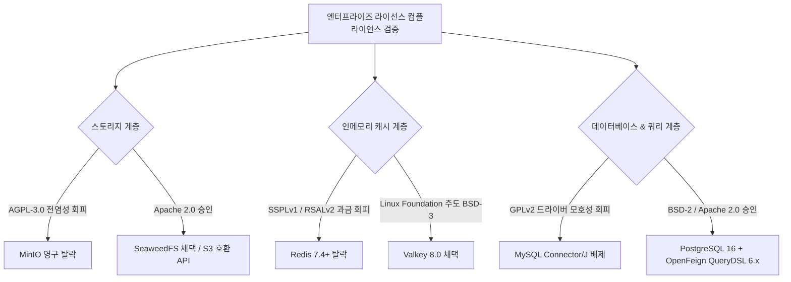
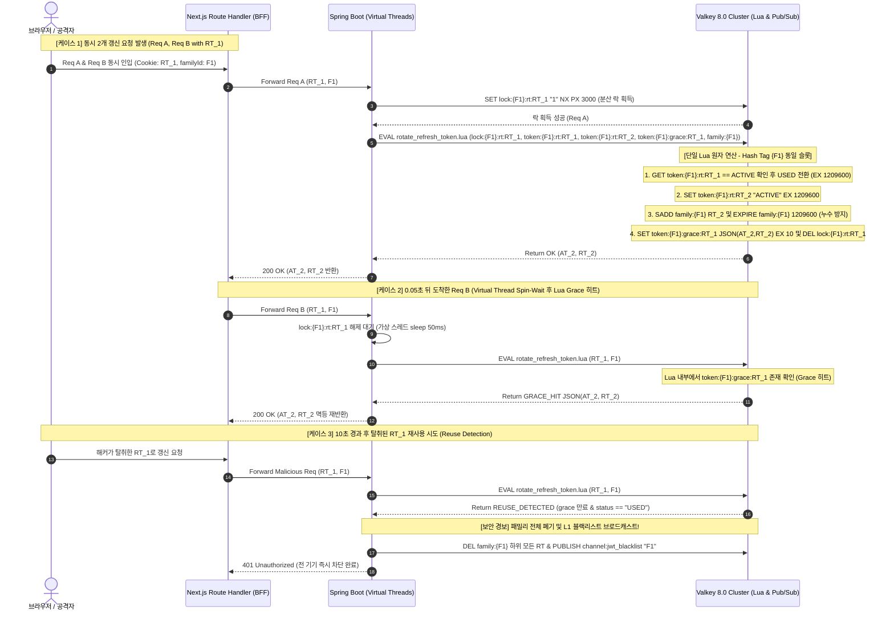
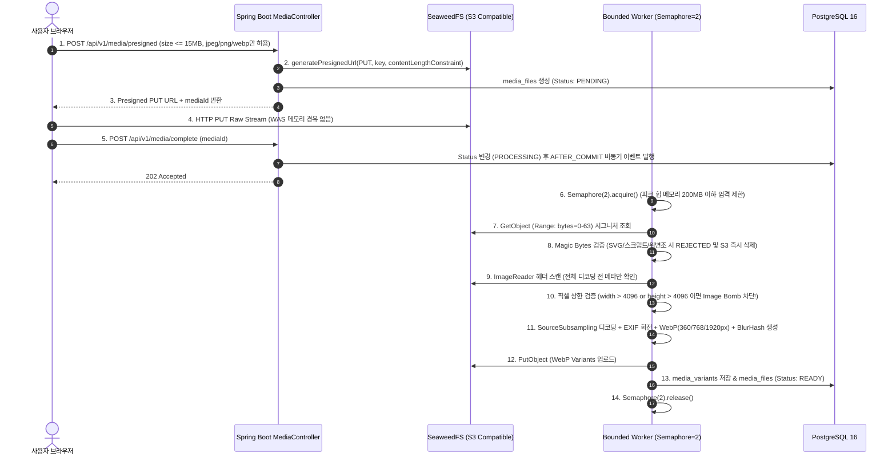
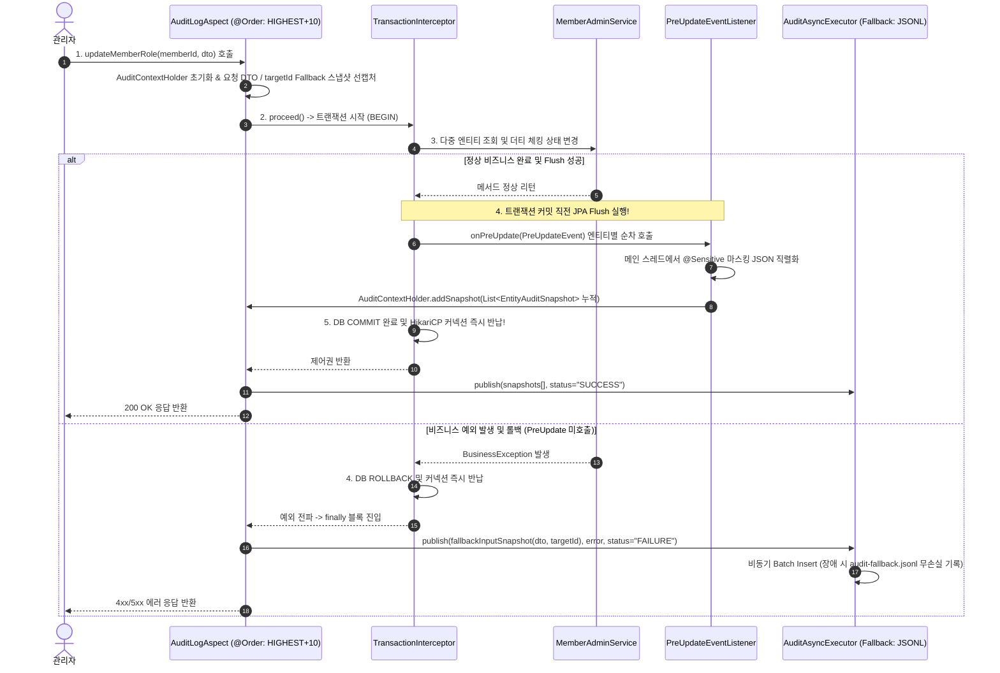
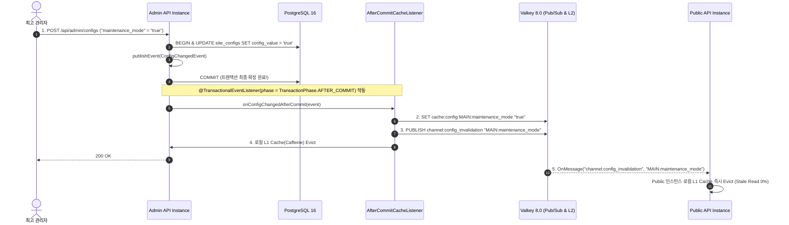
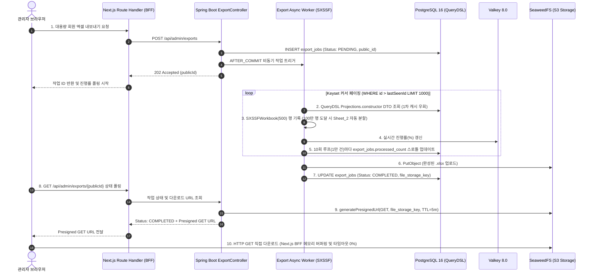

# 엔터프라이즈 홈페이지 & 관리자 통합 스타터 킷

## 상용화 기술 아키텍처 및 상세 기획서 (Technical Architecture & Engineering Specification)

> **버전**: v1.2.1-FREEZE (아키텍처 최종 동결판 — 메모리·트랜잭션·원자성·클러스터 호환성 무결점 검증 완료)
>
> **작성일**: 2026년 11월 17일
>
> **설계 원칙**: 100% 라이선스 클린(Apache 2.0/MIT/BSD), 실용적 헥사고날(Pragmatic Ports & Adapters) 기반 도메인 격리, 프로덕션 레디 5대 킬러 엔터프라이즈 기능 및 수학적 메모리 상한·원자성 방어 설계 내장

---

## 1. 프로젝트 개요 및 상용화 핵심 전제

### 1.1 제품 미션 및 15년 차 시니어 설계 가치

본 스타터 킷은 글로벌/국내 스타트업, SI 에이전시 및 엔터프라이즈 B2B SaaS 개발팀이 즉각 프로덕션에 투입할 수 있도록 설계된 **풀스택 상용화 베이스 프레임워크**입니다.

* **Time to Market 단축**: 신규 프로젝트 착수 시 2~3개월이 소요되는 인증/인가(소셜 로그인·2FA 포함), 관리자 CMS, 동적 권한(RBAC), 대용량 미디어 처리, 감사 로그, 엑셀 스트리밍, 주문·결제 상태 머신 등의 기반 작업을 0일로 단축합니다.
* **실용적 아키텍처와 커스터마이징 편의성 조화**: 계층 침범과 안티 패턴은 루트 프로젝트의 통합 ArchUnit 테스트 및 Gradle `runtimeOnly` 캡슐화로 원천 차단하되, 구매자가 컬럼 하나를 추가할 때 발생하는 불필요한 매퍼(Mapper) 보일러플레이트를 제거한 **실용적 도메인 모델(Pragmatic Domain Model)**을 채택했습니다.
* **운영 안정성(Zero-Fault Engineering)**: 대용량 이미지·엑셀 처리 시의 수학적 JVM 힙 메모리 상한 통제, JPA Flush 생명주기와 결합된 무결점 감사 로그, Lua Script 원자성 기반의 동시성 토큰 교환 및 탈취 감지, 트랜잭션 커밋 후(`AFTER_COMMIT`) 캐시 동기화 등 프로덕션 환경의 장애 포인트를 사전 방어 설계로 해결하였습니다.

### 1.2 100% 라이선스 안전성 보장 (Commercial Safe-Clean)

상용 솔루션 재판매 및 고객사 납품 시 소스코드 공개 의무나 듀얼 라이선스 과금 분쟁을 원천 차단하기 위해, **AGPL, SSPL, GPL, BSL, Commons Clause** 계열의 모든 오픈소스 및 컨테이너 이미지를 배제하고 **Apache 2.0 / MIT / BSD 2,3-Clause** 라이선스만을 채택합니다.

| 분류 | 채택 소프트웨어 | 적용 라이선스 | 비고 / 배제된 대안 (사유) |
| :--- | :--- | :--- | :--- |
| **인메모리 캐시 / 분산락** | **Valkey 8.0** | **BSD-3-Clause** | Redis 7.4+ (RSALv2 / SSPLv1 상용화 제한 및 클라우드 과금 이슈로 영구 배제) |
| **오브젝트 스토리지** | **SeaweedFS 3.x** | **Apache 2.0** | MinIO (AGPL-3.0 상용 패키징 시 소스코드 전면 공개 전염성 리스크로 배제) |
| **RDBMS / 드라이버** | **PostgreSQL 16.x** | **PostgreSQL / BSD-2** | MySQL 8.x (GPLv2 Connector/J 상용 임베딩 배포 시 법무 리스크 차단) |
| **동적 쿼리 빌더** | **OpenFeign QueryDSL 6.x** | **Apache 2.0** | 원조 QueryDSL 5.x (유지보수 중단 및 Jakarta EE 10+ 호환 패치 지연 대체) |
| **로컬 SMTP 테스팅** | **Mailpit** | **MIT License** | MailHog (유지보수 중단 및 아카이빙 이슈 대체) |
| **백엔드 프레임워크** | **Spring Boot 3.4+ / Java 21 LTS** | **Apache 2.0** | 가상 스레드(`Virtual Threads`) 기본 활성화 (공공/금융권 납품 시 전자정부 5.0 런타임 호환 및 ISMS-P 감사 요건 즉시 충족) |
| **프론트엔드 프레임워크** | **Next.js 15+ / React 19** | **MIT License** | App Router, Route Handler(BFF), shadcn/ui + TanStack Table (100% MIT) |

### 1.3 올인원 도입 편의성 및 운영 경제성 (Zero-Vendor Lock-in)

* **로컬 1-클릭 환경 (Docker Compose V2)**: `docker compose up -d` 명령어 하나로 PostgreSQL 16, Valkey 8, SeaweedFS(S3 호환 + 초기 버킷 자동 생성 컨테이너 포함), Mailpit이 버전 고정(Pinning) 및 헬스체크 상태로 구동됩니다.
* **클라우드 스위칭 투명성**: AWS(S3, ElastiCache, RDS) 또는 NCP/GCP/Azure 전환 시 코드 변경 없이 환경 변수(`.env` / `application.yml`) 교체만으로 즉시 마이그레이션됩니다.

---

## 2. 5대 기술 조건 의사결정 및 라이선스 방어 전략

### 2.1 5대 기술 스택 의사결정 매트릭스

1. **경량 멀티 모듈 + 워커 실행 격리**: Gradle Multi-Module (`starter-core`, `starter-infra`, `starter-app-api-public`, `starter-app-api-admin`) 구조를 통해 대고객 API와 관리자 API의 배포 바이너리를 물리적으로 분리하고, 백그라운드 스케줄러/워커는 프로퍼티 조건(`starter.worker.enabled=true`)을 통해 단일 진입점에서만 실행되도록 격리합니다.
2. **Next.js 15 App Router + OpenAPI 계약 자동화**: 백엔드 OpenAPI 3.1 스펙으로부터 프론트엔드 TypeScript 타입과 API 클라이언트를 자동 생성(`orval` / `openapi-typescript`)하여 API 스펙 불일치를 컴파일 타임에 차단합니다.
3. **PostgreSQL 16 + OpenFeign QueryDSL 6.x + Flyway**: 상태 변경(Command)은 JPA 엔티티 더티 체킹을 활용하고, 조회·통계·엑셀(Query)은 QueryDSL DTO 프로젝션을 사용하는 **경량 CQRS**와 Partial Unique Index 기반의 Soft Delete를 적용합니다.
4. **Stateless JWT + Valkey Lua RTR + Java 21 가상 스레드**: 평상시 API 인가는 서명 검증과 로컬 L1 블랙리스트 캐시만으로 완전 무상태(Stateless) 처리하며, 토큰 갱신(RTR)은 **단일 Valkey Lua Script**로 원자성을 보장하고 관리자 전용 TOTP 2FA(RFC 6238)를 기본 탑재합니다.
5. **실용적 Ports & Adapters + Transactional Outbox**: 핵심 도메인이 외부 SDK에 오염되지 않도록 Outbound Port 인터페이스로 격리하고, 이메일·알림톡·웹훅은 Outbox 패턴으로 발송 보장성을 확보합니다.

### 2.2 심층 라이선스 리스크 제로 방어 전략



---

## 3. 최종 시스템 아키텍처 청사진 & 모듈 구조

### 3.1 실용적 헥사고날(Pragmatic Ports & Adapters) 아키텍처 모델

순수 POJO 도메인 객체와 JPA 엔티티를 억지로 분리할 때 발생하는 매퍼(Mapper) 지옥과 더티 체킹 상실 문제를 방지하기 위해, **`starter-core` 내부에 JPA 어노테이션과 `@Transactional`까지만 제한적으로 허용**하고 구체적인 영속성 구현체(QueryDSL, 외부 연동 SDK, 배치 워커)는 `starter-infra`로 격리합니다.

```
+-----------------------------------------------------------------------------------+
|                     Presentation Layer (starter-app-api-*)                        |
|  [Public REST API (Stateless)]          [Admin Web API + Background Workers]      |
+----------------------------------------+------------------------------------------+
                                         | Inbound UseCases & DTOs (Compile-time)
                                         v
+-----------------------------------------------------------------------------------+
|                      Core Domain Layer (starter-core)                             |
|   [JPA Domain Entities & Aggregates]   [Domain Services (@Transactional)]         |
|   -----------------------------------------------------------------------------   |
|   [Outbound Ports]: MemberQueryPort, MediaStoragePort, AuditLogPort, PaymentPort  |
+----------------------------------------+------------------------------------------+
                                         | AutoConfiguration Binding (RuntimeOnly)
                                         v
+-----------------------------------------------------------------------------------+
|                   Infrastructure Layer (starter-infra)                            |
|  [Spring Data JPA + OpenFeign QueryDSL]   [Valkey Lua Engine]   [SeaweedFS S3]    |
|  [Hibernate Audit EventListener]   [SXSSF Excel Engine]   [Conditional Workers]   |
+-----------------------------------------------------------------------------------+
```

### 3.2 Gradle 멀티 모듈 의존성 및 워커 중복 실행 방지 구조

```
homepage (Root Project - 전체 모듈 통합 ArchUnit 검증 태스크 수행)
 ├── starter-core              (도메인 엔티티, 비즈니스 서비스, 입출력 Port 인터페이스, 공통 예외)
 ├── starter-infra             (QueryDSL 구현체, Valkey/S3/Mail 어댑터, SXSSF 엔진, 조건부 스케줄러, Flyway)
 ├── starter-app-api-public    (대고객 서비스 API — starter.worker.enabled=false 기본 적용)
 ├── starter-app-api-admin     (관리자 백오피스 API — starter.worker.enabled=true 워커 전담 구동)
 └── frontend/                 (Next.js 15 App Router 모노레포 / shadcn/ui 기반)
```

* **엄격한 의존성 격리 및 AutoConfiguration 조립**:
  * `starter-infra` ➔ `implementation(project(":starter-core"))`
  * `starter-app-api-*` ➔ `implementation(project(":starter-core"))`, `runtimeOnly(project(":starter-infra"))`
  * `starter-infra`의 어댑터 빈들은 `META-INF/spring/org.springframework.boot.autoconfigure.AutoConfiguration.imports`에 등록되어, `app-api`가 컴파일 타임에 `starter-infra` 클래스를 직접 참조(import)하는 것을 원천 차단하면서도 런타임에는 완벽히 조립됩니다.
* **백그라운드 워커 중복 실행 차단 (`@ConditionalOnProperty`)**:
  * `OutboxPollingPublisher`, `AuditPartitionScheduler`, `OrphanMediaCleanupJob` 등 모든 `@Scheduled` 워커 클래스에는 `@ConditionalOnProperty(prefix = "starter.worker", name = "enabled", havingValue = "true")`를 선언합니다.
  * `starter-app-api-public`에서는 해당 옵션을 `false`로 두어 대고객 API 서버의 CPU/DB 폴링 부하를 없애고, `starter-app-api-admin`(또는 별도 분리된 워커 인스턴스)에서만 배치가 실행되도록 제어합니다.

### 3.3 루트 통합 ArchUnit 계층 검증 규칙

`app-api`가 `starter-infra`를 `runtimeOnly`로 참조하므로, **루트 프로젝트(`build.gradle.kts`)의 통합 아키텍처 테스트 소스셋**에서 4개 모듈 전체 바이트코드를 한 번에 스캔하여 계층 침범을 검사합니다.

```java
@AnalyzeClasses(packages = "com.starterkit", importOptions = ImportOption.DoNotIncludeTests.class)
public class ArchitectureLayerRulesTest {

    // 1. Core 모듈은 Infra 및 App(Web) 모듈의 어떠한 클래스도 참조할 수 없다.
    @ArchTest
    static final ArchRule core_must_not_depend_on_infra_or_apps =
        noClasses().that().resideInAPackage("..core..")
            .should().dependOnClassesThat().resideInAnyPackage("..infra..", "..app..");

    // 2. Controller 및 App 계층은 Infra 어댑터(Repository, S3, POI 등)에 직접 접근할 수 없다.
    @ArchTest
    static final ArchRule app_must_not_access_infra_directly =
        noClasses().that().resideInAPackage("..app..")
            .should().dependOnClassesThat().resideInAPackage("..infra..");

    // 3. 도메인 엔티티(@Entity)는 Controller 계층의 요청/응답 시그니처로 직접 노출될 수 없다.
    @ArchTest
    static final ArchRule entities_must_not_leak_to_controllers =
        noMethods().that().areDeclaredInClassesThat().resideInAPackage("..controller..")
            .should().haveRawReturnType(annotatedWith(Entity.class))
            .orShould().haveRawParameterTypes(anyElementThat(annotatedWith(Entity.class)));
}
```

---

## 4. 5대 킬러 실무 보완 기능 상세 명세

### 4.1 [킬러 1] 수학적 힙 상한이 보장된 대용량 이미지 최적화 파이프라인

상용 유료 이미지 SaaS 없이 온프레미스/무료 오픈소스만으로 고해상도 이미지를 압축·서빙하며, **비압축 RGBA 힙 메모리 계산에 기반한 OOM 방어 및 Stored XSS 차단**을 내장한 파이프라인입니다.

```
[클라이언트 브라우저]
       │
       │ 1. Presigned Upload URL 요청 (최대 15MB, SVG 원천 차단)
       ▼
[Spring Boot Backend] ──(S3 Presigned PUT URL 발급)──> [클라이언트 브라우저]
       │                                                      │
       │ 3. 업로드 완료 콜백 (Upload Complete)                │ 2. 원본 직접 업로드 (WAS 경유 0%)
       ▼                                                      ▼
[Bounded Async Worker (Semaphore 동시 2건 제한)]       [SeaweedFS S3 Storage]
       │                                                      │
       ├─ Step A: S3 Range 요청(첫 64B)으로 Magic Bytes 검증 (SVG/실행파일 즉시 삭제)
       ├─ Step B: ImageReader 헤더 스캔 (픽셀 상한 4096x4096 초과 시 디코딩 거부)
       ├─ Step C: Subsampling 디코딩 + EXIF 회전 + Scrimage WebP(360px/768px/1920px) 변환
       ├─ Step D: 32px 축소 버퍼 기반 초경량 BlurHash 문자열 추출
       └─ Step E: 변환된 WebP Variants S3 업로드 ─────────────┘
```

* **수학적 힙 메모리 상한 통제 ($\le 256\text{ MB}$ 엄격 보장)**:
  1. **픽셀 상한선($4096 \times 4096$) 및 Image Bomb 차단**: 자바 `BufferedImage`(RGBA 4바이트) 디코딩 시 $4096 \times 4096 \times 4\text{ bytes} \approx 67.1\text{ MB}$가 소요됩니다. 전체 이미지를 메모리에 올리기 전 `TwelveMonkeys ImageReader`로 헤더만 읽어 가로·세로 $4096\text{ px}$(또는 총 픽셀 $16.7\text{ MP}$) 초과 시 디코딩 없이 즉시 거부합니다.
  2. **Source Subsampling & Semaphore(2) 동시성 제한**: 리사이징 시 원본 버퍼와 타깃 버퍼를 합쳐 1장당 최대 약 $100\text{ MB}$의 힙이 사용됩니다. `ImageReadParam.setSourceSubsampling()`으로 작은 해상도 생성 시 디코딩 단계부터 샘플링하여 메모리를 절약하고, 워커 동시 실행을 `Semaphore(2)`로 제한하여 피크 타임에도 이미지 처리용 총 힙 메모리가 절대 $200 \sim 256\text{ MB}$를 넘지 않도록 수학적으로 통제합니다.
* **보안 및 레티나 디스플레이 디테일**:
  * **SVG 업로드 원천 차단**: SVG 내부에 악성 `<script>`를 심는 Stored XSS 공격을 막기 위해 래스터 이미지(`image/jpeg`, `image/png`, `image/webp`)만 허용하고 S3 `Range: bytes=0-63` 매직 바이트 검증으로 위변조를 차단합니다.
  * **Retina 대응 해상도**: 고해상도 모바일/Mac 디스플레이(2x/3x)에서 썸네일이 뭉개지지 않도록 `thumbnail(360px)`, `medium(768px)`, `large(1920px)` WebP 포맷과 32글자 BlurHash를 생성합니다.
  * **고아 파일(Orphan File) 정리 배치**: Presigned URL만 발급받고 업로드를 중단한 `PENDING` 상태 데이터(24시간 경과)와 미완료 S3 객체를 매일 새벽 자동 삭제합니다.

### 4.2 [킬러 2] 트랜잭션 Flush 순서가 보장된 감사 로그(@AuditLog) & 무손실 Fallback

개인정보보호법(ISMS-P)을 만족하며, **AOP 실행 순서 역전 버그와 `LazyInitializationException`, 커넥션 풀 데드락을 모두 해결한 감사 추적 시스템**입니다.

```java
@Target(ElementType.METHOD)
@Retention(RetentionPolicy.RUNTIME)
public @interface AuditLog {
    ActionType action();                 // CREATE, UPDATE, DELETE, VIEW, EXPORT
    DomainType domain();                 // MEMBER, ORDER, ROLE, SYSTEM_CONFIG
    String targetId() default "";        // SpEL 지원: "#id" 또는 "#result.id"
    boolean capturePayload() default true;
}
```

* **AOP 우선순위(`@Order`) 교정, 다중 스냅샷 누적 및 실패 Fallback 캡처**:
  1. **Flush 순서 역전 해결**: JPA의 `PreUpdateEventListener`는 비즈니스 메서드가 끝날 때가 아니라 바깥쪽 `TransactionInterceptor`가 커밋(Flush)할 때 실행됩니다. 따라서 `AuditLogAspect`에 `@Order(Ordered.HIGHEST_PRECEDENCE + 10)`을 부여하여 **`TransactionInterceptor`보다 바깥쪽에서 감싸도록 설계**합니다.
  2. **다중 엔티티 수정 누적 (`List<EntityAuditSnapshot>`) & `LazyInitializationException` 원천 차단**: 한 트랜잭션 내에서 여러 엔티티가 변경될 때 스냅샷이 덮어씌워지는 것을 방지하기 위해 요청 스코프의 `AuditContextHolder`는 단일 객체가 아닌 **`List<EntityAuditSnapshot>`**을 누적 관리합니다. Hibernate의 `PreUpdateEventListener` / `PreDeleteEventListener`가 호출되는 즉시 **메인 스레드(영속성 컨텍스트 활성 상태)에서 `@Sensitive` 마스킹이 적용된 JSON 문자열로 직렬화를 완료**해 리스트에 순차 적재합니다.
  3. **비즈니스 예외 롤백 대비 실패 Fallback 입력 스냅샷 사전 캡처**: 비즈니스 예외 발생으로 트랜잭션이 롤백되면 Hibernate `PreUpdate` 자체가 호출되지 않습니다. 이를 보완하기 위해 **`AuditLogAspect` 진입 시점(AOP Before)에 요청 DTO와 SpEL 기반 `targetId`를 Fallback 입력 스냅샷으로 먼저 캡처**해 두어, 롤백(`FAILURE`) 시에도 빈 껍데기 로그가 아닌 요청 컨텍스트와 오류 원인이 온전히 남도록 보장합니다.
  4. **트랜잭션 종료 후 비동기 적재**: `TransactionInterceptor`가 커밋 또는 롤백을 마치고 DB 커넥션을 반납한 직후, 바깥쪽 `AuditLogAspect`의 `finally` 블록이 실행되어 누적된 `EntityAuditSnapshot` 목록(또는 실패 시 Fallback 입력 스냅샷)과 성공/실패 여부(`execution_status`)를 취합해 전용 비동기 워커(`AuditAsyncExecutor`)로 전달합니다.
* **무손실 Fallback 메커니즘 (Zero-Loss Audit)**:
  * 비동기 메모리 큐가 포화 상태이거나 DB 장애로 Batch Insert가 실패할 경우, 감사 로그가 유실되지 않도록 전용 로컬 롤링 파일(`logs/audit-fallback.jsonl`) 및 Valkey Stream으로 즉시 우회 기록(Fallback)한 뒤 복구 워커가 재적재합니다.

### 4.3 [킬러 3] 무상태 JWT + Valkey Lua 원자적 RTR + Java 21 가상 스레드 인증

평상시 API 호출 시에는 완전한 무상태(Stateless) 성능을 유지하면서, 토큰 갱신 시에는 **단일 Lua Script 원자 연산과 탈취 감지**를 수행하는 아키텍처입니다.

* **평상시 API 호출의 완전 무상태화 (Zero Valkey Hop)**:
  * `Access Token`(수명 15분) 검증 시 매번 Valkey 화이트리스트를 조회하지 않습니다. 서버는 자체 공개키/시크릿 서명 검증과 로컬 인메모리 L1 캐시(`Caffeine`)에 존재하는 `blacklist:family:{familyId}` 여부만 확인하여 $0.01\text{ ms}$ 만에 인가를 통과시킵니다.
  * 토큰 탈취나 강제 로그아웃 발생 시에만 Valkey Pub/Sub을 통해 모든 서버의 L1 블랙리스트에 해당 `familyId`(TTL 15분)를 전파합니다.
* **단일 Lua Script 기반 원자적 RTR, Valkey Cluster Hash Tag 및 10초 Grace Window**:
  * **Valkey Cluster `CROSSSLOT` 방지 Hash Tag (`{familyId}`) 적용**: Valkey Cluster 환경에서 다중 키를 다루는 Lua Script의 `CROSSSLOT` 에러를 원천 차단하기 위해 RTR 관련 모든 키에 `{familyId}` Hash Tag를 부여합니다(`lock:{F1}:rt:RT_1`, `token:{F1}:rt:RT_1`, `token:{F1}:rt:RT_2`, `token:{F1}:grace:RT_1`, `family:{F1}`).
  * **원자적 상태 전이 및 패밀리 Set 만료(`EXPIRE`) 관리**: 기존 토큰 상태 변경(`USED`), 신규 토큰 저장(`ACTIVE`), 패밀리 Set 등록(`SADD family:{F1} RT_2`)과 함께 **`family:{F1}` Set에도 Refresh Token과 동일한 `EXPIRE`(1,209,600초 / 14일)를 설정하여 영구 메모리 누수를 방지**하며, 10초 유예 캐시 등록(`SET token:{F1}:grace:RT_1 ... EX 10`) 및 락 해제까지 **`rotate_refresh_token.lua` 단일 스크립트로 묶어 실행**합니다.
  * 동시 요청(`Req B`) 인입 시 최대 $500\text{ ms}$의 Spin-wait 대기는 **Java 21 가상 스레드(`spring.threads.virtual.enabled=true`)** 위에서 동작하므로 OS 플랫폼 스레드 블로킹(톰캣 스레드 고갈)이 전혀 발생하지 않으며, 락 해제 대기 후 동일하게 `EVAL rotate_refresh_token.lua`를 호출해 Lua 내부에서 `token:{F1}:grace:RT_1` 유예 캐시를 확인·반환합니다.
* **탈취 감지(Reuse Detection) 시 패밀리 일괄 폐기**:
  * 10초 유예 기간 경과 후 이미 `USED` 상태인 과거 Refresh Token이 재사용되면, 즉시 해당 `family:{F1}`의 모든 Refresh Token을 폐기하고 `blacklist:family:{familyId}`를 Pub/Sub으로 브로드캐스트하여 해커와 정상 사용자의 전 기기 세션을 즉시 차단합니다.

### 4.4 [킬러 4] SXSSF + QueryDSL DTO 프로젝션 & 자동 시트 분할 엑셀 스트리밍

* **QueryDSL DTO 프로젝션 + Keyset(No-Offset) 페이징**: JPA 1차 캐시(영속성 컨텍스트)에 엔티티가 쌓이지 않도록 `Projections.constructor` DTO 조회와 `WHERE id > :lastSeenId ORDER BY id ASC LIMIT 1000` 커서 방식을 결합합니다.
* **단일 시트 한계 돌파 (자동 Sheet Split)**: Excel(`.xlsx`) 단일 시트 최대 행 수($1,048,576$행) 제한을 넘지 않도록 시트당 $1,000,000$행 도달 시 자동으로 `Sheet_2`, `Sheet_3`를 생성하고, `SXSSFWorkbook(500)`으로 메모리 상주 행을 500개로 제한합니다.
* **진행률 스로틀링**: 실시간 진행률(%)은 Valkey에 갱신하고 DB `export_jobs` 업데이트는 10회 루프(1만 건)마다 1회씩만 수행합니다.
* **Presigned GET URL 직접 다운로드 (BFF 메모리/타임아웃 회피)**: 비동기 생성이 완료(`COMPLETED`)된 `export_jobs` 파일은 Next.js Route Handler(BFF)를 경유해 스트리밍할 때 발생할 수 있는 메모리 버퍼링 및 타임아웃을 원천 피하기 위해, 백엔드가 **S3/SeaweedFS Presigned GET URL**을 발급해 브라우저가 오브젝트 스토리지에서 직접 다운로드하도록 처리합니다.

### 4.5 [킬러 5] 트랜잭션 커밋 후(`AFTER_COMMIT`) 동적 설정 변경 및 RBAC 캐시 동기화

* **2-Level Cache (Local Caffeine L1 + Valkey L2)**: 사이트 설정, 약관, 동적 메뉴 트리와 RBAC 권한 맵을 L1/L2 2단계로 캐싱합니다.
* **`AFTER_COMMIT` 무효화 보장**: `@TransactionalEventListener(phase = TransactionPhase.AFTER_COMMIT)`를 사용하여 PostgreSQL 트랜잭션 커밋이 완전히 확정된 직후에만 Valkey L2 갱신 및 Pub/Sub 로컬 캐시 무효화 메시지를 발행함으로써 Stale Cache Read를 원천 방지합니다.

---

## 5. 핵심 도메인 데이터 모델링 및 ERD 명세

### 5.1 데이터베이스 아키텍처, PK 이원화 및 Soft Delete 표준

* **내부 PK 및 외부 식별자 이원화**:
  * **내부 기본키(`id`)**: B-Tree 인덱스 성능과 Keyset 페이징을 위해 모든 테이블에 `BIGINT GENERATED ALWAYS AS IDENTITY`를 적용합니다.
  * **외부 노출 식별자(`public_id`)**: 외부 API 경로에 노출되는 엔티티(`members`, `orders`, `export_jobs`)는 시간순 정렬이 가능한 **`UUID` (UUIDv7)** 컬럼을 사용해 ID 추측 공격(IDOR)을 방어합니다.
* **PostgreSQL Partial Index 기반 Soft Delete**:
  * 주요 엔티티에 `deleted_at TIMESTAMP WITH TIME ZONE` 컬럼을 두어 논리 삭제를 수행합니다.
  * 탈퇴한 회원이 동일 이메일로 재가입하거나 삭제된 게시글의 `slug`를 재사용할 때 유니크 제약 충돌이 발생하지 않도록 **`WHERE deleted_at IS NULL` 조건부 부분 유니크 인덱스(Partial Unique Index)**를 적용합니다.

### 5.2 주요 테이블 스키마 DDL 정의서 (PostgreSQL 16 표준)

#### 1) members & member_oauth_accounts (대고객 회원 및 소셜 로그인)
```sql
CREATE TABLE members (
    id BIGINT GENERATED ALWAYS AS IDENTITY PRIMARY KEY,
    public_id UUID NOT NULL UNIQUE,               -- 외부 API 노출용 UUIDv7
    email VARCHAR(255) NOT NULL,
    password_hash VARCHAR(255),                   -- 소셜 전용 가입 시 NULL 허용
    nickname VARCHAR(100) NOT NULL,
    phone_number VARCHAR(50),
    status VARCHAR(30) NOT NULL DEFAULT 'ACTIVE', -- ACTIVE, SUSPENDED, WITHDRAWN
    role VARCHAR(30) NOT NULL DEFAULT 'USER',     -- USER, VIP
    site_code VARCHAR(50) NOT NULL DEFAULT 'MAIN',
    email_verified_at TIMESTAMP WITH TIME ZONE,
    last_login_at TIMESTAMP WITH TIME ZONE,
    created_at TIMESTAMP WITH TIME ZONE NOT NULL DEFAULT CURRENT_TIMESTAMP,
    updated_at TIMESTAMP WITH TIME ZONE NOT NULL DEFAULT CURRENT_TIMESTAMP,
    deleted_at TIMESTAMP WITH TIME ZONE           -- Soft Delete 타임스탬프
);
-- 탈퇴(deleted_at IS NOT NULL) 후 동일 이메일 재가입을 허용하는 부분 유니크 인덱스
CREATE UNIQUE INDEX uq_members_email_active ON members(email, site_code) WHERE deleted_at IS NULL;
CREATE INDEX idx_members_created_at ON members(created_at) WHERE deleted_at IS NULL;

CREATE TABLE member_oauth_accounts (
    id BIGINT GENERATED ALWAYS AS IDENTITY PRIMARY KEY,
    member_id BIGINT NOT NULL REFERENCES members(id) ON DELETE CASCADE,
    provider VARCHAR(30) NOT NULL,                -- GOOGLE, KAKAO, NAVER
    provider_user_id VARCHAR(255) NOT NULL,
    provider_email VARCHAR(255),
    connected_at TIMESTAMP WITH TIME ZONE NOT NULL DEFAULT CURRENT_TIMESTAMP,
    UNIQUE (provider, provider_user_id)
);
CREATE INDEX idx_oauth_member_id ON member_oauth_accounts(member_id);
```

#### 2) admins, roles, permissions, admin_roles, role_permissions (관리자 RBAC)
```sql
CREATE TABLE admins (
    id BIGINT GENERATED ALWAYS AS IDENTITY PRIMARY KEY,
    username VARCHAR(100) NOT NULL,
    password_hash VARCHAR(255) NOT NULL,
    full_name VARCHAR(100) NOT NULL,
    email VARCHAR(255) NOT NULL,
    status VARCHAR(30) NOT NULL DEFAULT 'ACTIVE', -- ACTIVE, LOCKED
    totp_secret VARCHAR(255),                     -- AES-256-GCM 암호화 저장된 Google 2FA Secret
    is_totp_enabled BOOLEAN NOT NULL DEFAULT FALSE,
    failed_login_attempts INT NOT NULL DEFAULT 0,
    created_at TIMESTAMP WITH TIME ZONE NOT NULL DEFAULT CURRENT_TIMESTAMP,
    updated_at TIMESTAMP WITH TIME ZONE NOT NULL DEFAULT CURRENT_TIMESTAMP,
    deleted_at TIMESTAMP WITH TIME ZONE
);
CREATE UNIQUE INDEX uq_admins_username_active ON admins(username) WHERE deleted_at IS NULL;
CREATE UNIQUE INDEX uq_admins_email_active ON admins(email) WHERE deleted_at IS NULL;

CREATE TABLE roles (
    id BIGINT GENERATED ALWAYS AS IDENTITY PRIMARY KEY,
    role_code VARCHAR(50) NOT NULL UNIQUE,        -- ROLE_SUPER_ADMIN, ROLE_CONTENT_MANAGER
    role_name VARCHAR(100) NOT NULL,
    description TEXT,
    created_at TIMESTAMP WITH TIME ZONE NOT NULL DEFAULT CURRENT_TIMESTAMP
);

CREATE TABLE permissions (
    id BIGINT GENERATED ALWAYS AS IDENTITY PRIMARY KEY,
    permission_code VARCHAR(100) NOT NULL UNIQUE, -- member:read, member:export, content:write
    permission_name VARCHAR(100) NOT NULL,
    resource_type VARCHAR(50) NOT NULL,
    created_at TIMESTAMP WITH TIME ZONE NOT NULL DEFAULT CURRENT_TIMESTAMP
);

CREATE TABLE admin_roles (
    admin_id BIGINT NOT NULL REFERENCES admins(id) ON DELETE CASCADE,
    role_id BIGINT NOT NULL REFERENCES roles(id) ON DELETE CASCADE,
    PRIMARY KEY (admin_id, role_id)
);

CREATE TABLE role_permissions (
    role_id BIGINT NOT NULL REFERENCES roles(id) ON DELETE CASCADE,
    permission_id BIGINT NOT NULL REFERENCES permissions(id) ON DELETE CASCADE,
    PRIMARY KEY (role_id, permission_id)
);
```

#### 3) menus (관리자 동적 메뉴 트리 구조)
```sql
CREATE TABLE menus (
    id BIGINT GENERATED ALWAYS AS IDENTITY PRIMARY KEY,
    parent_id BIGINT REFERENCES menus(id) ON DELETE CASCADE,
    menu_name VARCHAR(100) NOT NULL,
    route_path VARCHAR(255),
    icon_name VARCHAR(50),
    sort_order INT NOT NULL DEFAULT 0,
    is_visible BOOLEAN NOT NULL DEFAULT TRUE,
    required_permission VARCHAR(100),
    created_at TIMESTAMP WITH TIME ZONE NOT NULL DEFAULT CURRENT_TIMESTAMP
);
CREATE INDEX idx_menus_parent_sort ON menus(parent_id, sort_order);
```

#### 4) audit_logs (PostgreSQL 월별 파티셔닝 및 JSONB 스냅샷)
```sql
CREATE TABLE audit_logs (
    id BIGINT GENERATED ALWAYS AS IDENTITY,
    action_type VARCHAR(50) NOT NULL,             -- CREATE, UPDATE, DELETE, VIEW, EXPORT, AUTH_FAIL
    domain_type VARCHAR(50) NOT NULL,             -- MEMBER, ORDER, CMS, CONFIG, SECURITY
    target_id VARCHAR(100),
    actor_id VARCHAR(100) NOT NULL,               -- admin_id, member_id 또는 ANONYMOUS
    actor_type VARCHAR(30) NOT NULL,              -- ADMIN, USER, SYSTEM
    execution_status VARCHAR(20) NOT NULL DEFAULT 'SUCCESS', -- SUCCESS, FAILURE
    error_message TEXT,
    client_ip VARCHAR(45) NOT NULL,
    user_agent TEXT,
    before_state JSONB,                           -- 메인 스레드에서 @Sensitive 마스킹 직렬화된 스냅샷
    after_state JSONB,
    diff_payload JSONB,
    created_at TIMESTAMP WITH TIME ZONE NOT NULL DEFAULT CURRENT_TIMESTAMP,
    PRIMARY KEY (id, created_at)
) PARTITION BY RANGE (created_at);

CREATE TABLE audit_logs_2026_11 PARTITION OF audit_logs
    FOR VALUES FROM ('2026-11-01 00:00:00+00') TO ('2026-12-01 00:00:00+00');
CREATE TABLE audit_logs_default PARTITION OF audit_logs DEFAULT;

CREATE INDEX idx_audit_logs_actor ON audit_logs(actor_id, action_type, created_at DESC);
CREATE INDEX idx_audit_logs_domain_target ON audit_logs(domain_type, target_id, created_at DESC);
CREATE INDEX idx_audit_logs_diff_gin ON audit_logs USING gin (diff_payload);
```
* **파티션 프루닝 보장 규칙**: `audit_logs` 조회 API 및 QueryDSL 레포지토리는 반드시 `created_at` 범위 조건(`WHERE created_at >= :from AND created_at < :to`)을 강제하여 PostgreSQL 파티션 프루닝(Partition Pruning)과 복합 인덱스 스캔이 동시에 작동하도록 설계합니다.

#### 5) site_configs & common_codes (동적 설정 및 공통 코드)
```sql
CREATE TABLE site_configs (
    config_key VARCHAR(100) NOT NULL,
    site_code VARCHAR(50) NOT NULL DEFAULT 'MAIN',
    config_value TEXT NOT NULL,
    value_type VARCHAR(20) NOT NULL DEFAULT 'STRING', -- STRING, NUMBER, BOOLEAN, JSON
    group_name VARCHAR(50) NOT NULL,
    description TEXT,
    is_public BOOLEAN NOT NULL DEFAULT FALSE,
    updated_by VARCHAR(100),
    updated_at TIMESTAMP WITH TIME ZONE NOT NULL DEFAULT CURRENT_TIMESTAMP,
    PRIMARY KEY (config_key, site_code)
);

CREATE TABLE common_codes (
    group_code VARCHAR(50) NOT NULL,
    code_value VARCHAR(50) NOT NULL,
    code_name VARCHAR(100) NOT NULL,
    sort_order INT NOT NULL DEFAULT 0,
    is_active BOOLEAN NOT NULL DEFAULT TRUE,
    extra_json JSONB,
    PRIMARY KEY (group_code, code_value)
);
```

#### 6) media_files & media_variants (미디어 파이프라인)
```sql
CREATE TABLE media_files (
    id BIGINT GENERATED ALWAYS AS IDENTITY PRIMARY KEY,
    original_filename VARCHAR(255) NOT NULL,
    storage_key VARCHAR(500) NOT NULL UNIQUE,
    content_type VARCHAR(100) NOT NULL,           -- image/jpeg, image/png, image/webp (SVG 차단)
    file_size BIGINT NOT NULL,
    width INT,
    height INT,
    blur_hash VARCHAR(100),
    status VARCHAR(30) NOT NULL DEFAULT 'PENDING',-- PENDING, PROCESSING, READY, REJECTED, FAILED
    uploaded_by VARCHAR(100),
    created_at TIMESTAMP WITH TIME ZONE NOT NULL DEFAULT CURRENT_TIMESTAMP,
    deleted_at TIMESTAMP WITH TIME ZONE
);
CREATE INDEX idx_media_orphan_cleanup ON media_files(status, created_at) WHERE status = 'PENDING';

CREATE TABLE media_variants (
    id BIGINT GENERATED ALWAYS AS IDENTITY PRIMARY KEY,
    media_file_id BIGINT NOT NULL REFERENCES media_files(id) ON DELETE CASCADE,
    variant_type VARCHAR(30) NOT NULL,            -- THUMBNAIL(360px), MEDIUM(768px), LARGE(1920px)
    storage_key VARCHAR(500) NOT NULL,
    format VARCHAR(20) NOT NULL DEFAULT 'WEBP',
    width INT NOT NULL,
    height INT NOT NULL,
    file_size BIGINT NOT NULL,
    created_at TIMESTAMP WITH TIME ZONE NOT NULL DEFAULT CURRENT_TIMESTAMP
);
CREATE INDEX idx_media_variants_file ON media_variants(media_file_id, variant_type);
```

#### 7) orders & payment_transactions (표준 주문·결제 상태 머신 및 멱등성 관리)
```sql
CREATE TABLE orders (
    id BIGINT GENERATED ALWAYS AS IDENTITY PRIMARY KEY,
    public_id UUID NOT NULL UNIQUE,               -- 외부 노출 및 PG 주문번호 매핑용 UUIDv7
    member_id BIGINT NOT NULL REFERENCES members(id),
    order_name VARCHAR(255) NOT NULL,
    total_amount NUMERIC(15, 2) NOT NULL,
    currency VARCHAR(10) NOT NULL DEFAULT 'KRW',
    status VARCHAR(30) NOT NULL DEFAULT 'PENDING',-- PENDING, PAID, FAILED, CANCELLED, REFUNDED
    created_at TIMESTAMP WITH TIME ZONE NOT NULL DEFAULT CURRENT_TIMESTAMP,
    updated_at TIMESTAMP WITH TIME ZONE NOT NULL DEFAULT CURRENT_TIMESTAMP
);
CREATE INDEX idx_orders_member_created ON orders(member_id, created_at DESC);

CREATE TABLE payment_transactions (
    id BIGINT GENERATED ALWAYS AS IDENTITY PRIMARY KEY,
    order_id BIGINT NOT NULL REFERENCES orders(id),
    idempotency_key VARCHAR(100) NOT NULL UNIQUE, -- 중복 결제/웹훅 방어용 멱등성 키
    pg_provider VARCHAR(50) NOT NULL,             -- MOCK, TOSS, PORTONE, STRIPE
    pg_transaction_id VARCHAR(255),
    amount NUMERIC(15, 2) NOT NULL,
    status VARCHAR(30) NOT NULL,                  -- READY, APPROVED, FAILED, CANCELLED
    raw_webhook_payload JSONB,
    created_at TIMESTAMP WITH TIME ZONE NOT NULL DEFAULT CURRENT_TIMESTAMP
);
CREATE INDEX idx_payment_tx_order ON payment_transactions(order_id);
```

#### 8) export_jobs, outbox_events, cms_contents
```sql
CREATE TABLE export_jobs (
    id BIGINT GENERATED ALWAYS AS IDENTITY PRIMARY KEY,
    public_id UUID NOT NULL UNIQUE,
    job_type VARCHAR(50) NOT NULL,                -- MEMBER_LIST, AUDIT_LOGS, ORDERS
    status VARCHAR(30) NOT NULL DEFAULT 'PENDING',-- PENDING, PROCESSING, COMPLETED, FAILED
    total_count INT NOT NULL DEFAULT 0,
    processed_count INT NOT NULL DEFAULT 0,
    file_storage_key VARCHAR(500),
    requester_id VARCHAR(100) NOT NULL,
    error_message TEXT,
    started_at TIMESTAMP WITH TIME ZONE,
    completed_at TIMESTAMP WITH TIME ZONE,
    created_at TIMESTAMP WITH TIME ZONE NOT NULL DEFAULT CURRENT_TIMESTAMP
);

CREATE TABLE outbox_events (
    id BIGINT GENERATED ALWAYS AS IDENTITY PRIMARY KEY,
    aggregate_type VARCHAR(100) NOT NULL,         -- MEMBER, ORDER, INQUIRY, SECURITY_ALERT
    aggregate_id VARCHAR(100) NOT NULL,
    event_type VARCHAR(100) NOT NULL,             -- SEND_EMAIL, SEND_ALIMTALK, SEND_WEBHOOK
    payload JSONB NOT NULL,
    status VARCHAR(30) NOT NULL DEFAULT 'PENDING',-- PENDING, PUBLISHED, FAILED
    retry_count INT NOT NULL DEFAULT 0,
    next_retry_at TIMESTAMP WITH TIME ZONE NOT NULL DEFAULT CURRENT_TIMESTAMP,
    created_at TIMESTAMP WITH TIME ZONE NOT NULL DEFAULT CURRENT_TIMESTAMP
);
CREATE INDEX idx_outbox_pending ON outbox_events(status, next_retry_at) WHERE status = 'PENDING';

CREATE TABLE cms_contents (
    id BIGINT GENERATED ALWAYS AS IDENTITY PRIMARY KEY,
    slug VARCHAR(200) NOT NULL,
    site_code VARCHAR(50) NOT NULL DEFAULT 'MAIN',
    title VARCHAR(300) NOT NULL,
    category VARCHAR(50) NOT NULL,                -- NOTICE, FAQ, TERMS, BANNER, POPUP
    content_html TEXT,
    content_json JSONB,
    view_count BIGINT NOT NULL DEFAULT 0,
    is_published BOOLEAN NOT NULL DEFAULT FALSE,
    published_at TIMESTAMP WITH TIME ZONE,
    author_id VARCHAR(100),
    created_at TIMESTAMP WITH TIME ZONE NOT NULL DEFAULT CURRENT_TIMESTAMP,
    updated_at TIMESTAMP WITH TIME ZONE NOT NULL DEFAULT CURRENT_TIMESTAMP,
    deleted_at TIMESTAMP WITH TIME ZONE
);
-- 삭제된 콘텐츠의 slug 재사용을 허용하는 부분 유니크 인덱스
CREATE UNIQUE INDEX uq_cms_slug_active ON cms_contents(slug, site_code) WHERE deleted_at IS NULL;
```

---

## 6. 5대 핵심 비즈니스 처리 흐름 시퀀스 다이어그램

### 6.1 [시퀀스 1] 단일 Lua Script 원자적 JWT RTR, Valkey Cluster Hash Tag 및 10초 Grace Window

4개의 Valkey 상태 변경 명령을 `{familyId}` Hash Tag가 적용된 단일 Lua 스크립트로 원자화(Cluster `CROSSSLOT` 방지 + `family:{F1}` EXPIRE 누수 방지)하고, Java 21 가상 스레드 위에서 Spin-wait 후 Lua 내부에서 Grace Window를 확인하는 흐름입니다.



### 6.2 [시퀀스 2] 수학적 힙 상한($\le 256\text{ MB}$)이 보장된 이미지 최적화 파이프라인

`Semaphore(2)` 동시성 제한, S3 Range 매직 바이트 검사(SVG 차단), $4096 \times 4096$ 픽셀 상한 검증 및 Subsampling 디코딩 흐름입니다.



### 6.3 [시퀀스 3] `@AuditLog` 다중 스냅샷 누적 & 실패 Fallback 입력 캡처 흐름

`AuditLogAspect`가 `TransactionInterceptor` 바깥에서 동작하여 진입 시점에 요청 DTO/`targetId` Fallback 스냅샷을 선캡처하고, 커밋 시점에는 `AuditContextHolder`에 다중 엔티티 변경분(`List<EntityAuditSnapshot>`)을 누적해 무손실로 기록하는 흐름입니다.



### 6.4 [시퀀스 4] 트랜잭션 커밋 후(`AFTER_COMMIT`) 동적 설정 변경 및 Pub/Sub 전파



### 6.5 [시퀀스 5] QueryDSL DTO 프로젝션 & 자동 시트 분할 엑셀 스트리밍 + Presigned 다운로드

영속성 컨텍스트 1차 캐시 누적 없이 대용량 엑셀을 스트리밍 생성하고, 완료된 파일은 Next.js BFF를 경유하지 않고 S3 Presigned GET URL로 브라우저가 직접 다운로드하는 흐름입니다.



---

## 7. 부록: 도커 컴포즈(Docker Compose V2) 무결점 로컬 구동 스펙

환경 변수 기본값 보간(`${VAR:-default}`), 전 서비스 Healthcheck, 그리고 **SeaweedFS 초기 S3 버킷(`starter-bucket`) 자동 생성 초기화 컨테이너**를 포함하여 구동 즉시 파일 업로드가 가능한 프로덕션급 구성입니다.

```yaml
services:
  postgres:
    image: postgres:16.4-alpine
    container_name: starter-postgres
    restart: unless-stopped
    environment:
      POSTGRES_DB: ${POSTGRES_DB:-starter_db}
      POSTGRES_USER: ${POSTGRES_USER:-starter_user}
      POSTGRES_PASSWORD: ${POSTGRES_PASSWORD:-starter_secure_password_2026}
    ports:
      - "${POSTGRES_PORT:-5432}:5432"
    volumes:
      - pgdata:/var/lib/postgresql/data
    healthcheck:
      test: ["CMD-SHELL", "pg_isready -U $${POSTGRES_USER} -d $${POSTGRES_DB}"]
      interval: 5s
      timeout: 5s
      retries: 5

  valkey:
    image: valkey/valkey:8.0.1-alpine
    container_name: starter-valkey
    restart: unless-stopped
    command: ["valkey-server", "--requirepass", "${VALKEY_PASSWORD:-valkey_secure_pass_2026}", "--appendonly", "yes"]
    ports:
      - "${VALKEY_PORT:-6379}:6379"
    volumes:
      - valkeydata:/data
    healthcheck:
      test: ["CMD", "valkey-cli", "-a", "${VALKEY_PASSWORD:-valkey_secure_pass_2026}", "ping"]
      interval: 5s
      timeout: 3s
      retries: 5

  seaweedfs:
    image: chrislusf/seaweedfs:3.79
    container_name: starter-seaweedfs
    restart: unless-stopped
    command: "server -dir=/data -s3 -s3.port=8333 -filer"
    ports:
      - "${S3_PORT:-8333}:8333"
      - "9333:9333"
      - "8888:8888"
    volumes:
      - seaweeddata:/data
    healthcheck:
      test: ["CMD-SHELL", "wget -qO- http://localhost:9333/cluster/status >/dev/null 2>&1 || exit 1"]
      interval: 5s
      timeout: 5s
      retries: 5

  # SeaweedFS 기동 직후 기본 S3 버킷(starter-bucket)을 자동 생성하여 NoSuchBucket 에러 원천 차단
  seaweedfs-init:
    image: curlimages/curl:8.10.1
    container_name: starter-seaweedfs-init
    depends_on:
      seaweedfs:
        condition: service_healthy
    entrypoint:
      - /bin/sh
      - -c
      - |
        set -eu
        echo "Initializing default S3 bucket (starter-bucket) in SeaweedFS Filer..."
        for i in 1 2 3 4 5; do
          if curl -sf -X POST "http://seaweedfs:8888/buckets/starter-bucket/" >/dev/null; then
            echo "Default S3 bucket initialized successfully."
            exit 0
          fi
          HTTP_CODE=$$(curl -s -o /dev/null -w "%{http_code}" "http://seaweedfs:8888/buckets/starter-bucket/")
          if [ "$$HTTP_CODE" = "200" ] || [ "$$HTTP_CODE" = "409" ]; then
            echo "Default S3 bucket already exists (HTTP $$HTTP_CODE)."
            exit 0
          fi
          echo "Attempt $$i/5 failed (HTTP $$HTTP_CODE), retrying in 2s..."
          sleep 2
        done
        echo "ERROR: Failed to initialize SeaweedFS bucket after 5 attempts." >&2
        exit 1
    restart: "no"

  mailpit:
    image: axllent/mailpit:v1.21
    container_name: starter-mailpit
    restart: unless-stopped
    ports:
      - "${MAILPIT_UI_PORT:-8025}:8025"
      - "${MAILPIT_SMTP_PORT:-1025}:1025"
    healthcheck:
      test: ["CMD", "/mailpit", "readyz"]
      interval: 5s
      timeout: 3s
      retries: 5

volumes:
  pgdata:
  valkeydata:
  seaweeddata:
```

---
*본 문서는 엔터프라이즈 멀티 모듈 스타터 킷(v1.2.1-FREEZE)의 최종 동결 아키텍처 및 구현 규격서이며, 전 컴포넌트는 상업적 용도로 자유롭게 재배포 및 변형이 가능합니다.*