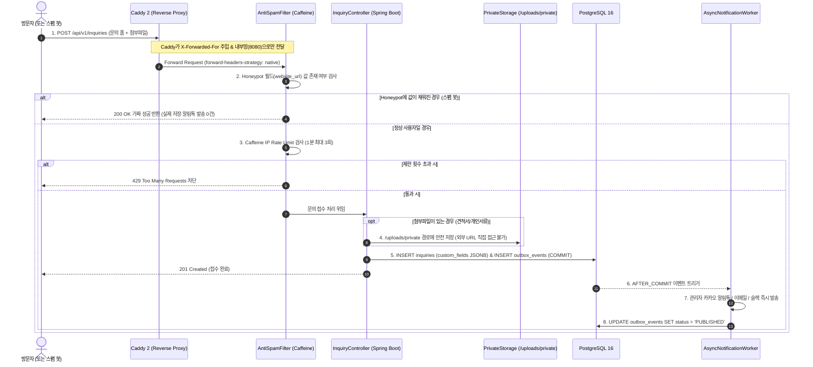
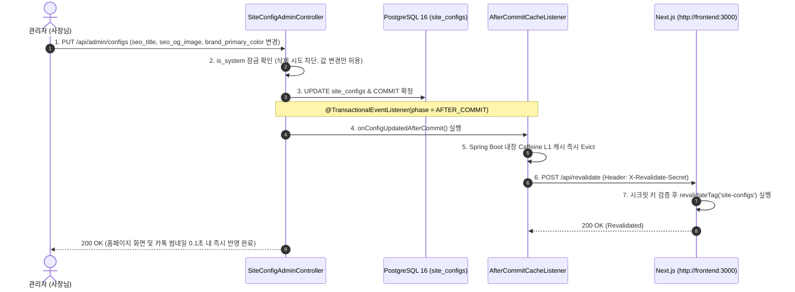
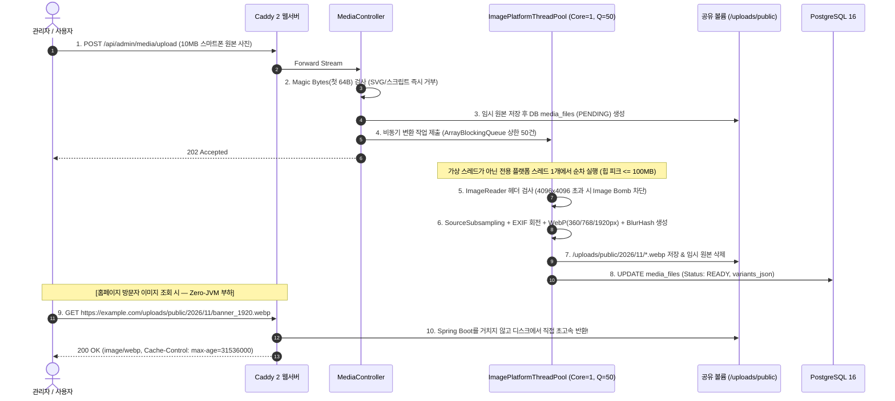
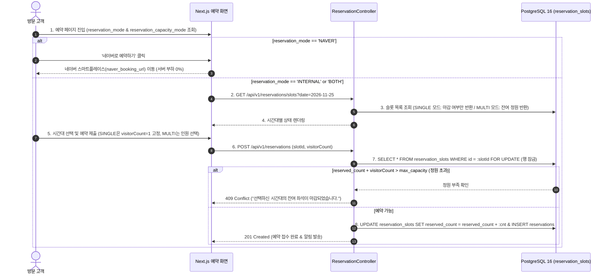

# 엔터프라이즈 & 외주 에이전시 통합 홈페이지 스타터 킷

## 상용화 기술 아키텍처 및 상세 기획서 (Technical Architecture & Engineering Specification)

> **버전**: v2.0-FINAL (크몽·외주 양산 및 템플릿 판매 최종 완결판 — 저가 서버 메모리·보안·캐시·하이브리드 예약 옵션 무결점 검증 완료)
>
> **작성일**: 2026년 11월 18일
>
> **설계 원칙**: 100% 라이선스 클린(Apache 2.0/MIT/BSD/OFL), 단일 모듈 패키지 격리(Modular Monolith) 기반 초고속 커스터마이징, 월 1만 원대(2GB RAM) 단일 서버 올인원 구동, 크몽 4대 킬러 기능(무코드 SEO·스팸방어 문의·하이브리드 예약[1:1 단독/N명 정원제 옵션]·WebP 자동 다이어트) 및 수학적 메모리 상한($\le 768\text{ MB}$) 방어 설계 내장

---

## 1. 프로젝트 개요 및 상용화 핵심 전제

### 1.1 제품 미션 및 비즈니스 가치

본 스타터 킷은 **① 크몽·숨고 등 외주 마켓에서의 초고속 홈페이지 제작·납품**, **② 코드 마켓플레이스(Standard / Pro 에디션) 템플릿 판매**, **③ 중소·중견기업 맞춤형 예약·결제·관리자 시스템 구축**을 단일 코드베이스로 달성하도록 설계된 **풀스택 상용화 베이스 프레임워크**입니다.

* **Time to Market 및 외주 수익성 극대화**: 신규 프로젝트 착수 시 반복 구현하는 인증/인가(소셜 로그인·선택형 2FA), 관리자 CMS, 동적 권한(RBAC), 코드 수정 없는 SEO·브랜딩 설정, 상담 문의(스팸 방어·실시간 알림), 하이브리드 예약(자체[1:1 단독 / N명 정원제 옵션] + 네이버 예약), 고화질 사진 자동 압축(WebP) 작업을 0일로 단축합니다.
* **초고속 커스터마이징을 위한 단일 모듈 패키지 격리(Pragmatic Modular Monolith)**: 4개로 쪼개져 있던 멀티 모듈과 내부 DB 조회용 포트(Port) 중복 선언을 제거하고 **단일 Spring Boot 프로젝트(`api`, `domain`, `infra` 패키지)**로 통합했습니다. 계층 침범은 `ArchUnit` 테스트로 차단하되, 게시판이나 컬럼 추가 시 수정 파일 수를 절반 이하로 줄여 작업 속도를 3배 높였습니다.
* **월 1만 원대 저가 서버 생존력 확보 (Zero-Overhead Infra)**: 외부 캐시(Valkey)나 무거운 스토리지 서버 없이 **Caddy(무료 자동 SSL) + Next.js(Standalone) + Spring Boot(768MB 제한) + PostgreSQL 16** 구성만으로 2GB RAM 가상 서버(VPS) 1대에서 쾌적하게 구동됩니다.
* **무결점 운영 안정성(Zero-Fault Engineering)**: CPU 집약적 이미지 변환의 전용 플랫폼 스레드 풀 격리(`FixedThreadPool(1)` + 대기열 50건 제한), 768MB 컨테이너 한도에 맞춘 수학적 JVM 메모리 배분 공식, 공개(`/uploads/public`)·비공개(`/uploads/private`) 파일 서빙 이원화, 관리자 실수 방지 잠금(`is_system`) 등 납품 후 CS와 장애 요인을 사전 차단했습니다.

### 1.2 100% 라이선스 안전성 보장 (소프트웨어 & 디자인 에셋)

상용 솔루션 재판매 및 고객사 납품 시 소스코드 공개 의무나 저작권 합의금 분쟁을 원천 차단하기 위해, **AGPL, SSPL, GPL, BSL** 계열 오픈소스를 전면 배제하고 **Apache 2.0 / MIT / BSD / OFL / CC0** 라이선스만을 채택합니다.

| 분류 | 기본 채택 기술 (Lite / 기본형) | 대규모 확장 옵션 (Enterprise) | 적용 라이선스 | 비고 / 비용 및 법무 방어 효과 |
| :--- | :--- | :--- | :--- | :--- |
| **웹서버 / SSL / 정적서빙** | **Caddy 2.x** | **Cloudflare + ALB** | **Apache 2.0** | 도메인 1개로 프론트·백엔드 통합, Let's Encrypt 무료 SSL 자동 갱신, `/uploads/public` 직접 서빙 |
| **프론트엔드 프레임워크** | **Next.js 15+ / React 19** | **Next.js 15+ (Multi-Node)** | **MIT License** | App Router, `output: 'standalone'` 경량 빌드, shadcn/ui + TanStack Table |
| **백엔드 프레임워크** | **Spring Boot 3.4+ / Java 21** | **Spring Boot 3.4+ (Scale-out)** | **Apache 2.0** | I/O 가상 스레드(`Virtual Threads`) + 이미지 변환 전용 플랫폼 스레드 풀(`FixedThreadPool(1)`) |
| **RDBMS / 동적 쿼리** | **PostgreSQL 16 + QueryDSL 6.x** | **PostgreSQL 16 HA** | **PostgreSQL / Apache 2.0** | MySQL GPLv2 드라이버 리스크 배제, OpenFeign QueryDSL 6.x 채택 |
| **캐시 / 토큰 / Rate Limit** | **Caffeine (L1) + PostgreSQL** | **Valkey 8.0 (BSD-3)** | **Apache 2.0 / BSD-3** | 기본 모드는 외부 캐시 서버 없이 내장 메모리와 DB 테이블만으로 100% 동작 |
| **파일 스토리지** | **Local Disk (`/uploads/*`)** | **Cloudflare R2 / SeaweedFS** | **Apache 2.0** | 기본 로컬 볼륨 사용, 용량 확장 시 Cloudflare R2(월 10GB·트래픽 무료) 설정 즉시 전환 |
| **폰트 / 아이콘 / 샘플사진** | **Pretendard / Lucide / Unsplash** | **좌동** | **OFL 1.1 / MIT / CC0** | 외주 납품 후 폰트·이미지 저작권 내용증명 분쟁 100% 원천 차단 |

### 1.3 상품화 패키지 구성 (Standard vs Pro 옵션 스위치 전략)

크몽 외주 견적(기본 홍보형 vs 맞춤형 예약·결제형) 및 템플릿 마켓 등급에 따라 코드 수정 없이 `application.yml` 설정(`starter.features.*`)과 관리자 설정(`site_configs`)만으로 기능을 켜고 끌 수 있습니다.

| 기능 분류 | 세부 모듈 | Standard (홍보·문의형) | Pro (예약·결제·기업형) | 설정 프로퍼티 (`starter.features.*`) |
| :--- | :--- | :---: | :---: | :--- |
| **코어 기본** | 회원/소셜로그인, RBAC 동적 메뉴, CMS 게시판 | 기본 포함 | 기본 포함 | 상시 활성화 (Core) |
| **크몽 킬러 1** | 무코드 SEO·브랜딩 관리 + Next.js 캐시 즉시 갱신 | 기본 포함 | 기본 포함 | 상시 활성화 (Core) |
| **크몽 킬러 2** | 동적 상담 문의(`inquiries`) + 스팸 방어 + 실시간 알림 | 기본 포함 | 기본 포함 | 상시 활성화 (Core) |
| **크몽 킬러 3** | 고화질 사진 WebP 자동 다이어트 + 공개/비공개 분리 | 기본 포함 | 기본 포함 | 상시 활성화 (Core) |
| **크몽 킬러 4** | 하이브리드 예약 시스템 (자체 예약 + 네이버 예약) | `NAVER` 링크 모드 | `INTERNAL` / `BOTH` | `reservation-mode: OFF \| NAVER \| INTERNAL \| BOTH`<br>`reservation-capacity-mode: SINGLE \| MULTI` |
| **Pro 확장 1** | 표준 주문·결제 상태 머신 (토스/포트원 멱등성 연동) | OFF | **ON** | `payment-enabled: true` |
| **Pro 확장 2** | 데이터 변경 감사 로그 (`@AuditLog` 단일 테이블) | OFF | **ON** | `audit-log-enabled: true` |
| **Pro 확장 3** | 회원·문의·예약 내역 엑셀 다운로드 (`SXSSF`) | OFF | **ON** | `excel-export-enabled: true` |
| **Pro 확장 4** | 관리자 Google OTP 2단계 인증 (TOTP 2FA) | OFF (사장님 편의) | **선택적 ON** | `admin-totp-enabled: false` (기본값 `false`) |

---

## 2. 초경량 기술 스택 및 유지비 최적화 아키텍처

### 2.1 단일 도메인 + Caddy 웹서버 기반 올인원 배포 구조

소규모 의뢰인이 추가 도메인 구매나 유료 SSL 인증서 비용을 지출하지 않도록, 앞단에 **Caddy 2** 웹서버를 배치하여 단일 도메인(`example.com`)으로 모든 트래픽을 라우팅하고 공개 이미지를 직접 서빙합니다.

```
                          [ 사용자 / 관리자 브라우저 ]
                                       │
                        HTTPS (443, Let's Encrypt 자동 갱신)
                                       ▼
+-----------------------------------------------------------------------------+
|  [Caddy 2 Reverse Proxy & Static Server] (컨테이너 메모리 ~40MB)             |
|   ├── /uploads/public/*  ──> 로컬 공유 볼륨 직접 초고속 서빙 (Zero-JVM 부하)|
|   ├── /uploads/private/* ──> 403 Forbidden 외부 직접 접근 원천 차단         |
|   ├── /api/*             ──> Spring Boot (내부망 8080 포트 단독 통신)       |
|   └── /* (그 외 모든 경로) ──> Next.js 15 Standalone (내부망 3000 포트)    |
+-----------------------------------------------------------------------------+
               │                                           │
               ▼ (Internal Expose 3000)                    ▼ (Internal Expose 8080)
+------------------------------+           +----------------------------------+
|  [Next.js 15 App Router]     | <───────  |  [Spring Boot 3.4 Single JAR]    |
|  - SSR 홍보 페이지 / SEO 메타| 즉시 캐시 |  - Public & Admin 통합 API       |
|  - 관리자 UI (shadcn/ui)     | 갱신 호출 |  - Caffeine L1 캐시 & Rate Limit |
|  - /api/revalidate (내부용)  |           |  - Image Worker (Pool=1, Q=50)   |
+------------------------------+           +----------------------------------+
                                                           │
                                                           ▼ (127.0.0.1:5432 내부 격리)
                                           +----------------------------------+
                                           |  [PostgreSQL 16 Alpine]          |
                                           |  - 비즈니스 데이터 & JSONB 폼    |
                                           |  - refresh_tokens & outbox_events|
                                           +----------------------------------+
```

### 2.2 2GB RAM 저가 서버 생존을 위한 수학적 JVM 메모리 배분 공식

Docker 컨테이너에 `mem_limit: 768m`만 설정하고 세부 JVM 옵션을 지정하지 않으면, Java 21이 기본 코드 캐시(`ReservedCodeCacheSize=240m`)와 힙을 과다 할당하여 리눅스 OOM Killer에 의해 서버가 강제 종료됩니다. 이를 막기 위해 **총 메모리 사용량이 726MB를 절대 넘지 않도록 수학적으로 통제**합니다.

* **컨테이너 메모리 한도**: $768\text{ MB}$
* **JVM 강제 옵션 (`JAVA_TOOL_OPTIONS`)**:
  ```text
  -Xms256m -Xmx420m -XX:MaxMetaspaceSize=128m -XX:ReservedCodeCacheSize=64m -XX:MaxDirectMemorySize=64m -XX:+UseSerialGC -XX:+ExitOnOutOfMemoryError
  ```
* **메모리 합산 검증 공식**:
  $$\text{Heap}(420\text{ MB}) + \text{Metaspace}(128\text{ MB}) + \text{CodeCache}(64\text{ MB}) + \text{DirectMemory}(64\text{ MB}) + \text{Native/Threads}(\approx 50\text{ MB}) = 726\text{ MB} \le 768\text{ MB}$$
* **이미지 변환 피크 힙 방어**: $4096 \times 4096$ 해상도 이미지 1장을 리사이징할 때 사용하는 힙 버퍼($\approx 100\text{ MB}$)는 `-Xmx420m` 내부에서 안전하게 소화되며, 동시 변환 스레드를 1개(`FixedThreadPool(1)`)로 제한하여 피크 시점에도 힙 여유분($320\text{ MB}$)이 항상 보장됩니다.

---

## 3. 빠른 커스터마이징을 위한 단일 모듈 패키지 아키텍처

### 3.1 실용적 패키지 격리 구조 (Single Module)

복잡한 멀티 모듈 대신 단일 Spring Boot 프로젝트 안에서 3계층 패키지(`api`, `domain`, `infra`)로만 역할을 분리합니다. 내부 DB 조회(JPA, QueryDSL)는 불필요한 중간 인터페이스(Port) 없이 서비스에서 바로 호출하여 개발 속도를 높이고, 외부 연동(스토리지, 알림 발송, PG 결제, 프론트 캐시 갱신)만 `domain` 내부의 Port 인터페이스로 추상화합니다.

```
starter-kit (Root Project)
 ├── backend/ (단일 Spring Boot 3.4 프로젝트)
 │    ├── src/main/java/com/starterkit/
 │    │    ├── common/               # [공통 유틸 계층] ApiResponse, BusinessException, 암호화
 │    │    ├── api/                  # [Presentation 계층]
 │    │    │    ├── publicapi/       # 대고객 컨트롤러 (/api/v1/*) & DTO
 │    │    │    ├── adminapi/        # 관리자 컨트롤러 (/api/admin/*) & DTO
 │    │    │    └── filter/          # JWT 인증 필터, Honeypot·IP Rate Limit 필터
 │    │    ├── domain/               # [Core 비즈니스 계층 — JPA/QueryDSL 직접 호출 + 외부 연동 Port 인터페이스]
 │    │    │    ├── member/          # 회원·소셜로그인·DB 토큰 엔티티, 서비스, Repository
 │    │    │    ├── cms/             # 사이트 설정(SEO), 동적 메뉴, 게시판, 배너 + CacheInvalidationPort
 │    │    │    ├── inquiry/         # 동적 상담 문의(JSONB) & 스팸 검증 서비스 + NotificationPort
 │    │    │    ├── reservation/     # 하이브리드 예약(1:1 단독 / N명 정원제 슬롯 & 네이버 연동)
 │    │    │    ├── media/           # 미디어 메타데이터 & StoragePort 인터페이스
 │    │    │    ├── order/           # [Pro] 주문·결제 상태 머신 & PaymentPort
 │    │    │    └── audit/           # [Pro] @AuditLog 어노테이션 & 단일 감사 로그
 │    │    └── infra/                # [외부 기술 구현체 계층 — domain의 Port 구현체]
 │    │         ├── config/          # Security, Virtual Thread, ImageThreadPool(1, Q=50)
 │    │         ├── storage/         # LocalStorageAdapter (기본) / S3R2StorageAdapter
 │    │         ├── image/           # TwelveMonkeys + Scrimage WebP 변환 워커
 │    │         ├── notification/    # 이메일, 카카오 알림톡, 슬랙/텔레그램 발송기, Next.js 캐시 갱신기
 │    │         └── excel/           # [Pro] SXSSF 엑셀 생성기
 │    └── src/test/java/com/starterkit/ArchitectureRulesTest.java
 ├── frontend/ (Next.js 15 App Router 모노레포 / shadcn/ui)
 ├── Caddyfile
 └── docker-compose.yml
```

### 3.2 ArchUnit 계층 검증 규칙 (단일 모듈 내 스파게티 코드 방지)

단일 모듈로 통합하더라도 엔티티가 컨트롤러로 직접 노출되거나 도메인이 외부 인프라 구현체에 오염되는 것은 `ArchUnit` 테스트로 엄격히 차단합니다.

```java
@AnalyzeClasses(packages = "com.starterkit", importOptions = ImportOption.DoNotIncludeTests.class)
public class ArchitectureRulesTest {

    // 1. Domain 계층은 API(컨트롤러/DTO)나 Infra(외부 어댑터 구현체)를 참조할 수 없다.
    @ArchTest
    static final ArchRule domain_must_not_depend_on_api_or_infra =
        noClasses().that().resideInAPackage("..domain..")
            .should().dependOnClassesThat().resideInAnyPackage("..api..", "..infra..");

    // 2. Public API와 Admin API 컨트롤러는 서로를 참조할 수 없다.
    @ArchTest
    static final ArchRule public_and_admin_api_must_be_isolated =
        noClasses().that().resideInAPackage("..api.publicapi..")
            .should().dependOnClassesThat().resideInAPackage("..api.adminapi..");

    // 3. JPA @Entity는 Controller 요청/응답 시그니처로 직접 노출될 수 없다 (DTO 변환 강제).
    @ArchTest
    static final ArchRule entities_must_not_leak_to_controllers =
        noMethods().that().areDeclaredInClassesThat().resideInAPackage("..api..")
            .should().haveRawReturnType(annotatedWith(Entity.class))
            .orShould().haveRawParameterTypes(anyElementThat(annotatedWith(Entity.class)));
}
```

---

## 4. 크몽 수주 특화 4대 핵심 기능 & 보안 안전장치 명세

### 4.1 [핵심 1] 코드 수정 없는 SEO·브랜딩 관리 & Next.js 캐시 즉시 갱신

크몽 의뢰인의 필수 요구사항인 **네이버·구글 검색 노출**과 **카카오톡 공유 썸네일(OpenGraph)**, **브랜드 색상·로고**를 재배포 없이 관리자 화면에서 즉시 변경합니다.

* **기본 탑재 SEO·브랜딩 설정 키 (`site_configs`)**:
  * **검색엔진 최적화**: `seo_title`(사이트 제목), `seo_description`(설명문), `seo_keywords`, `seo_og_image`(카톡 공유 썸네일 URL), `naver_site_verification`(네이버 서치어드바이저 인증 메타태그), `google_site_verification`, `robots_txt_custom`.
  * **화이트라벨링(브랜드 디자인)**: `brand_primary_color`(HEX 색상 코드 — Next.js CSS Variable `--primary`에 즉시 주입), `brand_logo_url`, `brand_favicon_url`, `footer_company_info`(상호, 대표자, 사업자번호, 주소 JSON).
* **사장님 실수 방지 잠금 (`is_system = true`)**:
  * 비개발자 의뢰인이 관리자 화면에서 필수 시스템 설정 키(`seo_title`, `reservation_mode` 등)나 핵심 메뉴(`menus`)를 실수로 삭제하지 못하도록 `is_system = true` 행은 값(Value)만 수정 가능하고 **삭제(`DELETE`) 및 키 변경을 서버 단에서 원천 차단(`403 Forbidden`)**합니다.
* **`AFTER_COMMIT` + Next.js On-Demand Revalidation (0.1초 화면 반영)**:
  * 관리자가 설정이나 배너를 수정하면 PostgreSQL 트랜잭션이 완전히 커밋된 직후(`@TransactionalEventListener(phase = TransactionPhase.AFTER_COMMIT)`), 백엔드 로컬 캐시(`Caffeine`)를 비움과 동시에 도커 내부망을 통해 Next.js의 `POST http://frontend:3000/api/revalidate`를 호출합니다.
  * 외부 해커가 캐시 초기화 API를 무단 호출하지 못하도록 내부 공유 암호키 헤더(`X-Revalidate-Secret`)를 검증하며, 검증 통과 즉시 `revalidateTag('site-configs')`가 실행되어 홈페이지 화면과 카톡 썸네일이 0.1초 만에 갱신됩니다.

### 4.2 [핵심 2] 업종별 동적 상담 문의(`inquiries`) + 스팸 봇 무료 방어막 + 실시간 알림

병원, 법무법인, 세무사, 인테리어, 제조업 등 업종마다 다른 문의 입력 항목을 DB 테이블 수정(`ALTER TABLE`) 없이 수용하고, 해외 스팸 봇으로부터 사장님의 알림톡 충전금을 보호합니다.

* **업종별 맞춤 확장 컬럼 (`custom_fields JSONB`)**:
  * 기본 컬럼(이름, 연락처, 이메일, 제목, 본문, 개인정보 동의 여부) 외에 업종별 특수 항목(예: 병원의 `희망진료과목`, 제조업의 `예산규모`·`납기일`)은 `custom_fields JSONB` 컬럼에 유연하게 저장합니다.
* **스팸 봇 3중 무료 방어막 (유료 캡차 없이 알림톡 비용 100% 방어)**:
  1. **Honeypot(꿀단지 숨김 필드) 검증**: 일반 사용자의 화면에는 CSS(`display: none`)로 숨겨진 `website_url` 필드에 값이 채워져 들어오면 자동화 스팸 봇으로 판정하여 DB 저장 및 알림 발송 없이 즉시 차단합니다.
  2. **Caffeine 내장 메모리 기반 IP Rate Limit**: 동일 클라이언트 IP에서 **1분 내 3회 초과(또는 1시간 내 10회 초과)** 문의 접수 시 `429 Too Many Requests`로 차단합니다.
  3. **프록시 실제 IP 인식 및 8080 포트 내부 격리**: 앞단 Caddy 웹서버를 거친 실제 사용자 IP를 정확히 식별하기 위해 Spring Boot에 `server.forward-headers-strategy: native`를 설정하고, 해커가 Caddy를 우회해 가짜 `X-Forwarded-For` 헤더를 직접 쏘지 못하도록 Docker Compose에서 Spring Boot 8080 포트는 외부에 열지 않고 내부망(`expose: ["8080"]`)으로만 격리합니다.
* **멀티 채널 실시간 알림 (`outbox_events` 연동)**:
  * 문의가 정상 저장되면 관리자가 설정한 알림 채널(**이메일, 카카오 알림톡, 슬랙 웹훅, 텔레그램 봇**)로 접수 내용을 즉시 비동기 발송합니다.

### 4.3 [핵심 3] 하이브리드 예약 시스템 (네이버 연동 + 자체 예약[1:1 단독 / N명 정원제 옵션])

관리자 설정(`site_configs`)의 **예약 채널 모드(`reservation_mode`)**와 **정원 운영 옵션(`reservation_capacity_mode`)** 두 가지 스위치 조합으로 모든 업종의 예약 요구사항을 코드 수정 없이 즉시 만족합니다.

#### 1) 제1스위치: 예약 채널 모드 (`reservation_mode`)
* `OFF`: 예약 기능 및 메뉴 숨김 (일반 기업 홍보 홈페이지용)
* `NAVER`: 홈페이지 예약 버튼 클릭 시 관리자에서 설정한 **네이버 스마트플레이스 예약 URL(`naver_booking_url`)**로 즉시 연결 (미용실, 음식점, 소규모 매장용 — 서버 부하 0%)
* `INTERNAL`: 홈페이지 내장 달력 및 시간대(Time Slot) 선택 폼을 통한 **자체 예약 접수**
* `BOTH`: '홈페이지 간편 예약'과 '네이버로 예약하기' 두 버튼을 동시에 노출

#### 2) 제2스위치: 자체 예약 정원 옵션 (`reservation_capacity_mode` — `SINGLE` vs `MULTI`)
업종에 따라 시간대당 1팀만 받는 곳과 여러 명을 동시에 받는 곳이 다르므로, 관리자 화면 또는 `application.yml`에서 즉시 전환할 수 있도록 옵션화했습니다.

| 정원 옵션 모드 | 추천 적용 업종 | 동작 방식 및 UI 표시 |
| :--- | :--- | :--- |
| **`SINGLE`**<br>*(1:1 단독 예약 모드)* | 법무·세무 상담, 1인샵, 렌탈 스튜디오, B2B 미팅 | • 슬롯의 `max_capacity = 1`로 고정 작동<br>• 누군가 해당 시간대를 예약하면 즉시 **'예약 마감'**으로 전환 (잔여석 숫자 미표시로 깔끔한 UI 제공) |
| **`MULTI`**<br>*(시간대별 N명 정원제 모드)* | 병원·의원 진료, 학원·원데이클래스, 네일샵, 체험장 | • 슬롯별 `max_capacity = N` (예: 14:00 타임 정원 5명) 설정 허용<br>• 화면에 **'잔여 2석 / 정원 5명'** 표시 및 방문 인원(`visitor_count`) 선택 활성화 |

* **초과 예약(Overbooking) 완벽 방어 및 결제 연동**:
  * 예약 접수 시 PostgreSQL 행 잠금(`SELECT ... FOR UPDATE`)과 DB `CHECK (reserved_count <= max_capacity)` 제약을 결합해, 외부 캐시(Valkey) 없이도 동시 클릭으로 인한 정원 초과를 100% 방어합니다.
  * 예약 확정·취소 시 고객과 관리자에게 카카오 알림톡/이메일이 자동 발송되며, Pro 옵션(`payment-enabled: true`) 활성화 시 예약금 결제(`orders`)와 즉시 연동됩니다.

### 4.4 [핵심 4] 스마트폰 원본 사진 자동 다이어트 (WebP) & 공개/비공개 저장소 이원화

의뢰인이나 고객이 10MB~15MB짜리 고화질 스마트폰 원본 사진을 올려도 서버가 멈추지 않고 가벼운 WebP 이미지로 자동 변환하며, 파일 성격에 따라 서빙 경로를 철저히 분리합니다.

* **가상 스레드 Pinning 방지용 전용 플랫폼 스레드 풀 & 대기열 상한**:
  * 이미지 디코딩과 WebP 압축은 CPU를 100% 사용하는 작업이므로 Java 21 가상 스레드에서 실행하면 OS 스레드 점유(Pinning) 현상이 발생합니다. 이를 막기 위해 이미지 변환 워커는 **단일 플랫폼 스레드 풀(`ThreadPoolExecutor(1, 1, 0L, MILLISECONDS, new ArrayBlockingQueue<>(50))`)**로 격리하여 피크 메모리를 $100\text{ MB}$ 이하로 묶고 대기열 폭주를 방지합니다.
* **Image Bomb(픽셀 폭탄) 및 악성 SVG 원천 차단**:
  * 업로드된 파일의 첫 64바이트(Magic Bytes)를 검사해 XSS 스크립트 삽입 위험이 있는 SVG 및 실행 파일을 즉시 거부하고, `TwelveMonkeys ImageReader`로 헤더만 먼저 스캔해 가로·세로 $4096 \times 4096$ 픽셀 초과 시 전체 디코딩 없이 즉시 차단합니다.
  * 정상 이미지는 `SourceSubsampling` 디코딩과 EXIF 자동 회전을 거쳐 `thumbnail(360px)`, `medium(768px)`, `large(1920px)` WebP 포맷 및 32글자 BlurHash로 변환합니다.
* **공개(`/uploads/public`) vs 비공개(`/uploads/private`) 폴더 이원화**:
  * **공개 미디어 (`/uploads/public`)**: 배너, 팝업, 공지사항, 갤러리 등 누구나 볼 수 있는 이미지는 WebP 변환 후 `/uploads/public` 볼륨에 저장하며, 조회 시 **Spring Boot를 거치지 않고 앞단 Caddy 웹서버가 직접 초고속 서빙(Zero-JVM 부하)**합니다.
  * **비공개 첨부파일 (`/uploads/private`)**: 고객이 상담 문의(`inquiries`)나 예약 시 첨부한 개인 서류(진료 기록, 계약서, 견적 도면 등)는 외부에서 URL로 절대 직접 접근할 수 없는 `/uploads/private` 폴더에 저장하며, 오직 **관리자 권한(`ROLE_ADMIN`) 인가를 통과한 후 Spring Boot 스트리밍 API(`GET /api/admin/media/{id}/download`)를 통해서만 다운로드**하도록 보호합니다.

---

## 5. 데이터베이스(ERD) 상세 스키마 정의서 (PostgreSQL 16 표준)

모든 테이블은 내부 조인용 `BIGINT IDENTITY` 기본키와 외부 API 노출용 `UUID`(UUIDv7) 식별자를 이원화하여 ID 추측 공격(IDOR)을 방어하며, `WHERE deleted_at IS NULL` 부분 유니크 인덱스(Partial Unique Index)를 통해 탈퇴 회원 재가입 및 슬러그 재사용 충돌을 방지합니다.

### 5.1 회원, 소셜 로그인 및 DB 기반 Refresh Token (`members`, `refresh_tokens`)
```sql
CREATE TABLE members (
    id BIGINT GENERATED ALWAYS AS IDENTITY PRIMARY KEY,
    public_id UUID NOT NULL UNIQUE,               -- 외부 API 노출용 UUIDv7
    email VARCHAR(255) NOT NULL,
    password_hash VARCHAR(255),                   -- 소셜 전용 가입 시 NULL 허용
    nickname VARCHAR(100) NOT NULL,
    phone_number VARCHAR(50),
    status VARCHAR(30) NOT NULL DEFAULT 'ACTIVE', -- ACTIVE, SUSPENDED, WITHDRAWN
    role VARCHAR(30) NOT NULL DEFAULT 'USER',     -- USER, VIP
    email_verified_at TIMESTAMP WITH TIME ZONE,
    last_login_at TIMESTAMP WITH TIME ZONE,
    created_at TIMESTAMP WITH TIME ZONE NOT NULL DEFAULT CURRENT_TIMESTAMP,
    updated_at TIMESTAMP WITH TIME ZONE NOT NULL DEFAULT CURRENT_TIMESTAMP,
    deleted_at TIMESTAMP WITH TIME ZONE
);
CREATE UNIQUE INDEX uq_members_email_active ON members(email) WHERE deleted_at IS NULL;

CREATE TABLE member_oauth_accounts (
    id BIGINT GENERATED ALWAYS AS IDENTITY PRIMARY KEY,
    member_id BIGINT NOT NULL REFERENCES members(id) ON DELETE CASCADE,
    provider VARCHAR(30) NOT NULL,                -- GOOGLE, KAKAO, NAVER
    provider_user_id VARCHAR(255) NOT NULL,
    provider_email VARCHAR(255),
    connected_at TIMESTAMP WITH TIME ZONE NOT NULL DEFAULT CURRENT_TIMESTAMP,
    UNIQUE (provider, provider_user_id)
);

-- Valkey 없이도 안전한 토큰 순환(RTR) 및 10초 Grace Window를 지원하는 테이블
CREATE TABLE refresh_tokens (
    id BIGINT GENERATED ALWAYS AS IDENTITY PRIMARY KEY,
    family_id UUID NOT NULL,
    token_hash VARCHAR(128) NOT NULL UNIQUE,
    subject_type VARCHAR(20) NOT NULL,            -- MEMBER, ADMIN
    subject_id BIGINT NOT NULL,
    status VARCHAR(20) NOT NULL DEFAULT 'ACTIVE', -- ACTIVE, USED, REVOKED
    replaced_by_token_hash VARCHAR(128),
    used_at TIMESTAMP WITH TIME ZONE,             -- USED 전환 후 10초 내 재요청 시 Grace 허용
    expires_at TIMESTAMP WITH TIME ZONE NOT NULL,
    created_at TIMESTAMP WITH TIME ZONE NOT NULL DEFAULT CURRENT_TIMESTAMP
);
CREATE INDEX idx_refresh_tokens_family ON refresh_tokens(family_id);
```

### 5.2 관리자 RBAC, 동적 메뉴 및 사이트 설정 (`admins`, `menus`, `site_configs`)
```sql
CREATE TABLE admins (
    id BIGINT GENERATED ALWAYS AS IDENTITY PRIMARY KEY,
    username VARCHAR(100) NOT NULL,
    password_hash VARCHAR(255) NOT NULL,
    full_name VARCHAR(100) NOT NULL,
    email VARCHAR(255) NOT NULL,
    status VARCHAR(30) NOT NULL DEFAULT 'ACTIVE', -- ACTIVE, LOCKED
    totp_secret VARCHAR(255),                     -- Pro 옵션: Google OTP 시크릿 (기본 비활성)
    is_totp_enabled BOOLEAN NOT NULL DEFAULT FALSE,
    failed_login_attempts INT NOT NULL DEFAULT 0,
    created_at TIMESTAMP WITH TIME ZONE NOT NULL DEFAULT CURRENT_TIMESTAMP,
    updated_at TIMESTAMP WITH TIME ZONE NOT NULL DEFAULT CURRENT_TIMESTAMP,
    deleted_at TIMESTAMP WITH TIME ZONE
);
CREATE UNIQUE INDEX uq_admins_username_active ON admins(username) WHERE deleted_at IS NULL;

CREATE TABLE roles (
    id BIGINT GENERATED ALWAYS AS IDENTITY PRIMARY KEY,
    role_code VARCHAR(50) NOT NULL UNIQUE,        -- ROLE_SUPER_ADMIN, ROLE_MANAGER
    role_name VARCHAR(100) NOT NULL,
    is_system BOOLEAN NOT NULL DEFAULT FALSE,     -- TRUE일 경우 관리자 화면에서 삭제 불가
    created_at TIMESTAMP WITH TIME ZONE NOT NULL DEFAULT CURRENT_TIMESTAMP
);

CREATE TABLE permissions (
    id BIGINT GENERATED ALWAYS AS IDENTITY PRIMARY KEY,
    permission_code VARCHAR(100) NOT NULL UNIQUE, -- inquiry:read, reservation:write, config:write
    permission_name VARCHAR(100) NOT NULL
);

CREATE TABLE admin_roles (
    admin_id BIGINT NOT NULL REFERENCES admins(id) ON DELETE CASCADE,
    role_id BIGINT NOT NULL REFERENCES roles(id) ON DELETE CASCADE,
    PRIMARY KEY (admin_id, role_id)
);

CREATE TABLE role_permissions (
    role_id BIGINT NOT NULL REFERENCES roles(id) ON DELETE CASCADE,
    permission_id BIGINT NOT NULL REFERENCES permissions(id) ON DELETE CASCADE,
    PRIMARY KEY (role_id, permission_id)
);

CREATE TABLE menus (
    id BIGINT GENERATED ALWAYS AS IDENTITY PRIMARY KEY,
    parent_id BIGINT REFERENCES menus(id) ON DELETE CASCADE,
    menu_type VARCHAR(20) NOT NULL DEFAULT 'PUBLIC', -- PUBLIC(홈페이지 헤더), ADMIN(관리자 사이드바)
    menu_name VARCHAR(100) NOT NULL,
    route_path VARCHAR(255) NOT NULL,
    icon_name VARCHAR(50),
    sort_order INT NOT NULL DEFAULT 0,
    is_visible BOOLEAN NOT NULL DEFAULT TRUE,
    is_system BOOLEAN NOT NULL DEFAULT FALSE,        -- 사장님 실수 삭제 방지 잠금 플래그
    required_permission VARCHAR(100),
    created_at TIMESTAMP WITH TIME ZONE NOT NULL DEFAULT CURRENT_TIMESTAMP
);
CREATE INDEX idx_menus_type_parent_sort ON menus(menu_type, parent_id, sort_order);

-- 코드 수정 없는 SEO, 브랜딩, 예약 모드/정원 옵션 스위치 관리 테이블
CREATE TABLE site_configs (
    config_key VARCHAR(100) PRIMARY KEY,
    config_value TEXT NOT NULL,
    value_type VARCHAR(20) NOT NULL DEFAULT 'STRING', -- STRING, NUMBER, BOOLEAN, JSON, COLOR, IMAGE
    group_name VARCHAR(50) NOT NULL,                  -- SEO, BRANDING, RESERVATION, NOTIFICATION, COMPANY
    description VARCHAR(255) NOT NULL,
    is_public BOOLEAN NOT NULL DEFAULT TRUE,          -- TRUE일 경우 홈페이지 렌더링 시 공개 조회 허용
    is_system BOOLEAN NOT NULL DEFAULT TRUE,          -- TRUE일 경우 키 삭제 절대 불가 (값만 수정 가능)
    updated_by VARCHAR(100),
    updated_at TIMESTAMP WITH TIME ZONE NOT NULL DEFAULT CURRENT_TIMESTAMP
);

-- 납품 즉시 관리자 화면에서 바로 제어 가능한 핵심 기본 시드(Seed) 데이터
INSERT INTO site_configs (config_key, config_value, value_type, group_name, description, is_public, is_system) VALUES
('seo_title', '정확하고 빠른 비즈니스 파트너 | 표준 기업 홈페이지', 'STRING', 'SEO', '브라우저 탭 및 검색 결과 제목', TRUE, TRUE),
('seo_description', '전문적인 상담과 맞춤형 솔루션을 제공합니다.', 'STRING', 'SEO', '네이버·구글 검색 결과 요약 설명문', TRUE, TRUE),
('seo_keywords', '기업홈페이지,전문상담,맞춤견적', 'STRING', 'SEO', '검색 키워드 (쉼표 구분)', TRUE, TRUE),
('seo_og_image', '/uploads/public/default-og.webp', 'IMAGE', 'SEO', '카카오톡·SNS 링크 공유 시 대표 썸네일', TRUE, TRUE),
('naver_site_verification', '', 'STRING', 'SEO', '네이버 서치어드바이저 인증 메타태그 값', TRUE, TRUE),
('google_site_verification', '', 'STRING', 'SEO', '구글 서치콘솔 인증 메타태그 값', TRUE, TRUE),
('brand_primary_color', '#4F46E5', 'COLOR', 'BRANDING', '홈페이지 메인 포인트 색상 (HEX)', TRUE, TRUE),
('brand_logo_url', '/uploads/public/logo.webp', 'IMAGE', 'BRANDING', '상단 헤더 로고 이미지 URL', TRUE, TRUE),
('footer_company_info', '{"name":"주식회사 스타터","ceo":"홍길동","bizNo":"123-45-67890","phone":"02-1234-5678","address":"서울시 강남구 테헤란로 123"}', 'JSON', 'COMPANY', '푸터 하단 사업자 정보', TRUE, TRUE),
('reservation_mode', 'BOTH', 'STRING', 'RESERVATION', '예약 채널 모드 (OFF | NAVER | INTERNAL | BOTH)', TRUE, TRUE),
('reservation_capacity_mode', 'SINGLE', 'STRING', 'RESERVATION', '자체 예약 정원 모드 (SINGLE: 1:1 단독예약 | MULTI: 시간대별 N명 정원제)', TRUE, TRUE),
('reservation_default_capacity', '1', 'NUMBER', 'RESERVATION', 'MULTI 모드 시 시간대별 기본 정원 수 (SINGLE 모드 시 1로 강제)', TRUE, TRUE),
('naver_booking_url', 'https://booking.naver.com/', 'STRING', 'RESERVATION', '네이버 스마트플레이스 예약 연결 주소', TRUE, TRUE);
```

### 5.3 [크몽 핵심] 동적 상담 문의 (`inquiries`) 및 하이브리드 예약 (`reservation_slots`, `reservations`)
```sql
CREATE TABLE inquiries (
    id BIGINT GENERATED ALWAYS AS IDENTITY PRIMARY KEY,
    public_id UUID NOT NULL UNIQUE,
    category VARCHAR(50) NOT NULL DEFAULT 'GENERAL', -- GENERAL, ESTIMATE, PARTNERSHIP
    customer_name VARCHAR(100) NOT NULL,
    customer_phone VARCHAR(50) NOT NULL,
    customer_email VARCHAR(255),
    title VARCHAR(300) NOT NULL,
    content TEXT NOT NULL,
    custom_fields JSONB NOT NULL DEFAULT '{}'::jsonb, -- 업종별 추가 입력 항목 (예산, 희망지역 등)
    attachment_media_id BIGINT,                       -- /uploads/private 에 저장된 비공개 첨부파일 ID
    privacy_agreed BOOLEAN NOT NULL DEFAULT TRUE,
    status VARCHAR(30) NOT NULL DEFAULT 'PENDING',    -- PENDING(접수대기), IN_PROGRESS(상담중), COMPLETED(완료), SPAM
    admin_memo TEXT,
    client_ip VARCHAR(45) NOT NULL,
    answered_by VARCHAR(100),
    answered_at TIMESTAMP WITH TIME ZONE,
    created_at TIMESTAMP WITH TIME ZONE NOT NULL DEFAULT CURRENT_TIMESTAMP,
    updated_at TIMESTAMP WITH TIME ZONE NOT NULL DEFAULT CURRENT_TIMESTAMP,
    deleted_at TIMESTAMP WITH TIME ZONE
);
CREATE INDEX idx_inquiries_status_created ON inquiries(status, created_at DESC) WHERE deleted_at IS NULL;

-- 자체 예약(INTERNAL/BOTH 모드) 시간대 및 정원 관리 테이블
-- reservation_capacity_mode = 'SINGLE' 시 max_capacity = 1 로 동작, 'MULTI' 시 시간대별 N명 정원 허용
CREATE TABLE reservation_slots (
    id BIGINT GENERATED ALWAYS AS IDENTITY PRIMARY KEY,
    slot_date DATE NOT NULL,
    slot_time TIME NOT NULL,
    service_name VARCHAR(100) NOT NULL DEFAULT 'DEFAULT',
    max_capacity INT NOT NULL DEFAULT 1,              -- SINGLE 모드: 1 고정 / MULTI 모드: N명 설정 가능
    reserved_count INT NOT NULL DEFAULT 0,
    is_closed BOOLEAN NOT NULL DEFAULT FALSE,
    created_at TIMESTAMP WITH TIME ZONE NOT NULL DEFAULT CURRENT_TIMESTAMP,
    UNIQUE (slot_date, slot_time, service_name),
    CONSTRAINT chk_slot_capacity CHECK (reserved_count >= 0 AND reserved_count <= max_capacity)
);

-- 자체 예약 접수 내역 테이블
CREATE TABLE reservations (
    id BIGINT GENERATED ALWAYS AS IDENTITY PRIMARY KEY,
    public_id UUID NOT NULL UNIQUE,
    slot_id BIGINT NOT NULL REFERENCES reservation_slots(id),
    member_id BIGINT REFERENCES members(id),          -- 비회원 예약도 허용 (NULL 가능)
    customer_name VARCHAR(100) NOT NULL,
    customer_phone VARCHAR(50) NOT NULL,
    customer_email VARCHAR(255),
    visitor_count INT NOT NULL DEFAULT 1,             -- SINGLE 모드: 1 고정 / MULTI 모드: 예약 인원수
    custom_fields JSONB NOT NULL DEFAULT '{}'::jsonb, -- 업종별 예약 추가 질문 (증상, 요청사항 등)
    status VARCHAR(30) NOT NULL DEFAULT 'REQUESTED',  -- REQUESTED, CONFIRMED, CANCELLED, COMPLETED, NO_SHOW
    order_id BIGINT,                                  -- Pro 결제 연동 시 예약금 주문 ID
    admin_memo TEXT,
    client_ip VARCHAR(45) NOT NULL,
    created_at TIMESTAMP WITH TIME ZONE NOT NULL DEFAULT CURRENT_TIMESTAMP,
    updated_at TIMESTAMP WITH TIME ZONE NOT NULL DEFAULT CURRENT_TIMESTAMP
);
CREATE INDEX idx_reservations_slot ON reservations(slot_id, status);
CREATE INDEX idx_reservations_phone ON reservations(customer_phone, created_at DESC);
```

### 5.4 미디어 파이프라인(공개/비공개 분리), CMS 및 Pro 확장 테이블
```sql
CREATE TABLE media_files (
    id BIGINT GENERATED ALWAYS AS IDENTITY PRIMARY KEY,
    public_id UUID NOT NULL UNIQUE,
    visibility VARCHAR(20) NOT NULL DEFAULT 'PUBLIC', -- PUBLIC(/uploads/public), PRIVATE(/uploads/private)
    original_filename VARCHAR(255) NOT NULL,
    storage_key VARCHAR(500) NOT NULL UNIQUE,
    content_type VARCHAR(100) NOT NULL,
    file_size BIGINT NOT NULL,
    width INT,
    height INT,
    blur_hash VARCHAR(100),
    variants_json JSONB DEFAULT '{}'::jsonb,          -- THUMBNAIL(360), MEDIUM(768), LARGE(1920) WebP 경로 통합 저장
    status VARCHAR(30) NOT NULL DEFAULT 'PENDING',    -- PENDING, PROCESSING, READY, REJECTED, FAILED
    uploaded_by VARCHAR(100),
    created_at TIMESTAMP WITH TIME ZONE NOT NULL DEFAULT CURRENT_TIMESTAMP,
    deleted_at TIMESTAMP WITH TIME ZONE
);

CREATE TABLE cms_contents (
    id BIGINT GENERATED ALWAYS AS IDENTITY PRIMARY KEY,
    slug VARCHAR(200) NOT NULL,
    category VARCHAR(50) NOT NULL,                    -- NOTICE, FAQ, PORTFOLIO, BANNER, POPUP, TERMS
    title VARCHAR(300) NOT NULL,
    summary VARCHAR(500),
    content_html TEXT,
    thumbnail_url VARCHAR(500),
    extra_json JSONB DEFAULT '{}'::jsonb,             -- 팝업 노출 좌표/기간, 포트폴리오 고객사명 등
    view_count BIGINT NOT NULL DEFAULT 0,
    is_pinned BOOLEAN NOT NULL DEFAULT FALSE,
    is_published BOOLEAN NOT NULL DEFAULT TRUE,
    is_system BOOLEAN NOT NULL DEFAULT FALSE,         -- 이용약관·개인정보처리방침 등 필수 문서 삭제 방지
    author_id VARCHAR(100),
    created_at TIMESTAMP WITH TIME ZONE NOT NULL DEFAULT CURRENT_TIMESTAMP,
    updated_at TIMESTAMP WITH TIME ZONE NOT NULL DEFAULT CURRENT_TIMESTAMP,
    deleted_at TIMESTAMP WITH TIME ZONE
);
CREATE UNIQUE INDEX uq_cms_slug_active ON cms_contents(slug, category) WHERE deleted_at IS NULL;

CREATE TABLE outbox_events (
    id BIGINT GENERATED ALWAYS AS IDENTITY PRIMARY KEY,
    aggregate_type VARCHAR(50) NOT NULL,              -- INQUIRY, RESERVATION, MEMBER, ORDER
    aggregate_id VARCHAR(100) NOT NULL,
    event_type VARCHAR(50) NOT NULL,                  -- SEND_ALIMTALK, SEND_EMAIL, SEND_SLACK
    payload JSONB NOT NULL,
    status VARCHAR(30) NOT NULL DEFAULT 'PENDING',    -- PENDING, PUBLISHED, FAILED
    retry_count INT NOT NULL DEFAULT 0,
    next_retry_at TIMESTAMP WITH TIME ZONE NOT NULL DEFAULT CURRENT_TIMESTAMP,
    created_at TIMESTAMP WITH TIME ZONE NOT NULL DEFAULT CURRENT_TIMESTAMP
);
CREATE INDEX idx_outbox_pending ON outbox_events(status, next_retry_at) WHERE status = 'PENDING';

-- [Pro 확장 옵션] 주문·결제 및 단일 감사 로그 테이블
CREATE TABLE orders (
    id BIGINT GENERATED ALWAYS AS IDENTITY PRIMARY KEY,
    public_id UUID NOT NULL UNIQUE,
    member_id BIGINT REFERENCES members(id),
    order_name VARCHAR(255) NOT NULL,
    total_amount NUMERIC(15, 2) NOT NULL,
    status VARCHAR(30) NOT NULL DEFAULT 'PENDING',    -- PENDING, PAID, CANCELLED, REFUNDED
    idempotency_key VARCHAR(100) NOT NULL UNIQUE,
    pg_provider VARCHAR(50),                          -- MOCK, TOSS, PORTONE
    pg_transaction_id VARCHAR(255),
    raw_webhook_payload JSONB,
    created_at TIMESTAMP WITH TIME ZONE NOT NULL DEFAULT CURRENT_TIMESTAMP,
    updated_at TIMESTAMP WITH TIME ZONE NOT NULL DEFAULT CURRENT_TIMESTAMP
);

CREATE TABLE audit_logs (
    id BIGINT GENERATED ALWAYS AS IDENTITY PRIMARY KEY,
    action_type VARCHAR(50) NOT NULL,                 -- CREATE, UPDATE, DELETE, EXPORT, LOGIN_FAIL
    domain_type VARCHAR(50) NOT NULL,                 -- CONFIG, INQUIRY, RESERVATION, MEMBER, ADMIN
    target_id VARCHAR(100),
    actor_id VARCHAR(100) NOT NULL,
    client_ip VARCHAR(45) NOT NULL,
    before_state JSONB,
    after_state JSONB,
    created_at TIMESTAMP WITH TIME ZONE NOT NULL DEFAULT CURRENT_TIMESTAMP
);
CREATE INDEX idx_audit_logs_created ON audit_logs(created_at DESC);
```

---

## 6. 핵심 비즈니스 작동 흐름 (시퀀스 다이어그램)

### 6.1 [시퀀스 1] 상담 문의 스팸 3중 방어 + 비공개 첨부파일 보호 + 실시간 알림 흐름



### 6.2 [시퀀스 2] 관리자 SEO·디자인 설정 변경 시 Next.js 0.1초 즉시 갱신 흐름



### 6.3 [시퀀스 3] 스마트폰 원본 사진 WebP 자동 다이어트 및 Caddy 직접 서빙 흐름



### 6.4 [시퀀스 4] 하이브리드 예약 (`NAVER` 링크 분기 vs `INTERNAL` [SINGLE 1:1 / MULTI 정원제] 동시성 방어)



---

## 7. 부록: 월 1만 원대(2GB RAM) 서버 올인원 배포 스펙

### 7.1 `docker-compose.yml` (표준 환경변수·포트 내부 격리·메모리 수학 공식·폴더 이원화 완결판)

```yaml
services:
  # 1. 앞단 웹서버: 자동 무료 SSL(HTTPS) + /uploads/public 직접 서빙 + 리버스 프록시
  caddy:
    image: caddy:2.8-alpine
    container_name: starter-caddy
    restart: unless-stopped
    ports:
      - "80:80"
      - "443:443"
      - "443:443/udp"
    environment:
      DOMAIN_NAME: ${DOMAIN_NAME:-localhost}
    volumes:
      - ./Caddyfile:/etc/caddy/Caddyfile:ro
      - uploads_public:/var/www/uploads/public:ro   # 읽기 전용 마운트로 공개 이미지만 직접 서빙
      - caddy_data:/data
      - caddy_config:/config
    depends_on:
      frontend:
        condition: service_started
      backend:
        condition: service_healthy
    mem_limit: 64m

  # 2. 프론트엔드: Next.js 15 Standalone 경량 실행 모드
  frontend:
    build:
      context: ./frontend
      dockerfile: Dockerfile
    container_name: starter-frontend
    restart: unless-stopped
    expose:
      - "3000"                                      # 외부 미노출 (Caddy 및 Backend와만 내부 통신)
    environment:
      NODE_ENV: production
      NODE_OPTIONS: "--max-old-space-size=256"
      INTERNAL_API_URL: http://backend:8080
      NEXT_PUBLIC_SITE_URL: https://${DOMAIN_NAME:-localhost}
      REVALIDATE_SECRET: ${REVALIDATE_SECRET:-starter_revalidate_secret_2026}
    depends_on:
      backend:
        condition: service_healthy
    mem_limit: 350m

  # 3. 백엔드: Spring Boot 3.4 단일 서버 (768MB 수학적 메모리 상한 적용)
  backend:
    build:
      context: ./backend
      dockerfile: Dockerfile
    container_name: starter-backend
    restart: unless-stopped
    expose:
      - "8080"                                      # 외부 직접 접근 원천 차단 (IP 위조 해킹 방어)
    environment:
      SPRING_PROFILES_ACTIVE: ${SPRING_PROFILE:-prod}
      SERVER_FORWARD_HEADERS_STRATEGY: native       # Caddy가 전달한 실제 클라이언트 IP 인식
      SPRING_DATASOURCE_URL: jdbc:postgresql://postgres:5432/${POSTGRES_DB:-starter_db}
      SPRING_DATASOURCE_USERNAME: ${POSTGRES_USER:-starter_user}
      SPRING_DATASOURCE_PASSWORD: ${POSTGRES_PASSWORD:-starter_secure_password_2026}
      STARTER_JWT_SECRET: ${JWT_SECRET:-replace_with_64_bytes_secure_random_key_for_production_2026}
      STARTER_REVALIDATE_URL: http://frontend:3000/api/revalidate
      STARTER_REVALIDATE_SECRET: ${REVALIDATE_SECRET:-starter_revalidate_secret_2026}
      # 420MB(Heap) + 128MB(Metaspace) + 64MB(CodeCache) + 64MB(Direct) + ~50MB(Native) = 726MB <= 768MB
      JAVA_TOOL_OPTIONS: >-
        -Xms256m -Xmx420m
        -XX:MaxMetaspaceSize=128m
        -XX:ReservedCodeCacheSize=64m
        -XX:MaxDirectMemorySize=64m
        -XX:+UseSerialGC
        -XX:+ExitOnOutOfMemoryError
    volumes:
      - uploads_public:/app/uploads/public          # 공개 WebP 이미지 저장소 (Caddy와 공유)
      - uploads_private:/app/uploads/private        # 비공개 문의 첨부파일 저장소 (Spring Boot 단독 접근)
    depends_on:
      postgres:
        condition: service_healthy
    healthcheck:
      test: ["CMD-SHELL", "wget -qO- http://localhost:8080/api/v1/health >/dev/null 2>&1 || exit 1"]
      interval: 10s
      timeout: 5s
      retries: 5
    mem_limit: 768m

  # 4. 데이터베이스: 외부 포트 차단(127.0.0.1 바인딩) 및 저메모리 튜닝 적용
  postgres:
    image: postgres:16.4-alpine
    container_name: starter-postgres
    restart: unless-stopped
    command: >
      postgres
      -c shared_buffers=128MB
      -c work_mem=4MB
      -c maintenance_work_mem=32MB
      -c max_connections=50
    environment:
      POSTGRES_DB: ${POSTGRES_DB:-starter_db}
      POSTGRES_USER: ${POSTGRES_USER:-starter_user}
      POSTGRES_PASSWORD: ${POSTGRES_PASSWORD:-starter_secure_password_2026}
    ports:
      - "127.0.0.1:${POSTGRES_PORT:-5432}:5432"     # 외부 인터넷 노출 차단 (SSH 터널링으로만 접속 가능)
    volumes:
      - pgdata:/var/lib/postgresql/data
    healthcheck:
      test: ["CMD-SHELL", "pg_isready -U $${POSTGRES_USER} -d $${POSTGRES_DB}"]
      interval: 5s
      timeout: 5s
      retries: 5
    mem_limit: 384m

volumes:
  pgdata:
  uploads_public:
  uploads_private:
  caddy_data:
  caddy_config:
```

### 7.2 `Caddyfile` (단일 도메인 라우팅·무료 SSL·공개 이미지 초고속 서빙 규격)

```caddyfile
{$DOMAIN_NAME:localhost} {
    encode zstd gzip

    # 1. 공개 이미지(/uploads/public/*)는 Spring Boot를 거치지 않고 Caddy가 직접 서빙
    handle_path /uploads/public/* {
        root * /var/www/uploads/public
        header Cache-Control "public, max-age=31536000, immutable"
        header X-Content-Type-Options "nosniff"
        file_server
    }

    # 2. 비공개 폴더(/uploads/private/*) 외부 URL 직접 접근 시 즉시 403 차단
    handle /uploads/private/* {
        respond "Forbidden" 403
    }

    # 3. 백엔드 API 및 Swagger 문서 요청 전달 (실제 클라이언트 IP 헤더 자동 전달)
    handle /api/* {
        reverse_proxy backend:8080
    }
    handle /swagger-ui/* {
        reverse_proxy backend:8080
    }
    handle /v3/api-docs* {
        reverse_proxy backend:8080
    }

    # 4. 그 외 모든 웹 페이지 요청은 Next.js 프론트엔드로 전달
    handle {
        reverse_proxy frontend:3000
    }
}
```

### 7.3 백엔드 핵심 설정 (`application.yml` 표준 규격)

```yaml
server:
  port: 8080
  forward-headers-strategy: native   # Caddy 리버스 프록시 뒤에서 실제 접속자 IP 식별 필수 옵션

spring:
  application:
    name: starter-backend
  threads:
    virtual:
      enabled: true                  # 일반 I/O API는 Java 21 가상 스레드로 고성능 처리
  datasource:
    url: ${SPRING_DATASOURCE_URL:jdbc:postgresql://localhost:5432/starter_db}
    username: ${SPRING_DATASOURCE_USERNAME:starter_user}
    password: ${SPRING_DATASOURCE_PASSWORD:starter_secure_password_2026}
  jpa:
    open-in-view: false
    hibernate:
      ddl-auto: validate
  flyway:
    enabled: true

starter:
  jwt:
    secret: ${STARTER_JWT_SECRET:replace_with_64_bytes_secure_random_key_for_production_2026}
  revalidate:
    url: ${STARTER_REVALIDATE_URL:http://localhost:3000/api/revalidate}
    secret: ${STARTER_REVALIDATE_SECRET:starter_revalidate_secret_2026}
  storage:
    type: ${STORAGE_TYPE:LOCAL}      # LOCAL (기본) 또는 S3_R2 (Cloudflare R2 무료 티어 확장 시)
    public-dir: /app/uploads/public
    private-dir: /app/uploads/private
  image-worker:
    core-pool-size: 1                # 768MB 컨테이너 내 피크 힙 메모리 방어를 위해 동시 1건으로 제한
    queue-capacity: 50               # ArrayBlockingQueue(50) 상한 설정
    max-pixel-dimension: 4096        # 4096x4096 초과 Image Bomb 즉시 거부
  rate-limit:
    inquiry-per-minute: 3            # 동일 IP당 1분 내 최대 3회 문의 허용
  features:
    reservation-mode: ${FEATURE_RESERVATION_MODE:BOTH}                # OFF | NAVER | INTERNAL | BOTH
    reservation-capacity-mode: ${FEATURE_RESERVATION_CAPACITY:SINGLE} # SINGLE (1:1 단독) | MULTI (시간대별 N명 정원제)
    reservation-default-capacity: ${FEATURE_RESERVATION_DEFAULT_CAP:1}
    payment-enabled: ${FEATURE_PAYMENT:false}
    audit-log-enabled: ${FEATURE_AUDIT_LOG:false}
    excel-export-enabled: ${FEATURE_EXCEL_EXPORT:true}
    admin-totp-enabled: ${FEATURE_ADMIN_TOTP:false}                   # 소상공인 편의를 위해 기본값 false
```

---
*본 문서는 크몽·숨고 외주 양산 및 템플릿 마켓 판매를 위해 최적화된 최종 완결 아키텍처 규격서(v2.0-FINAL)이며, 전 컴포넌트는 100% 상업적 재배포가 가능한 클린 라이선스로 구성되어 있습니다.*
