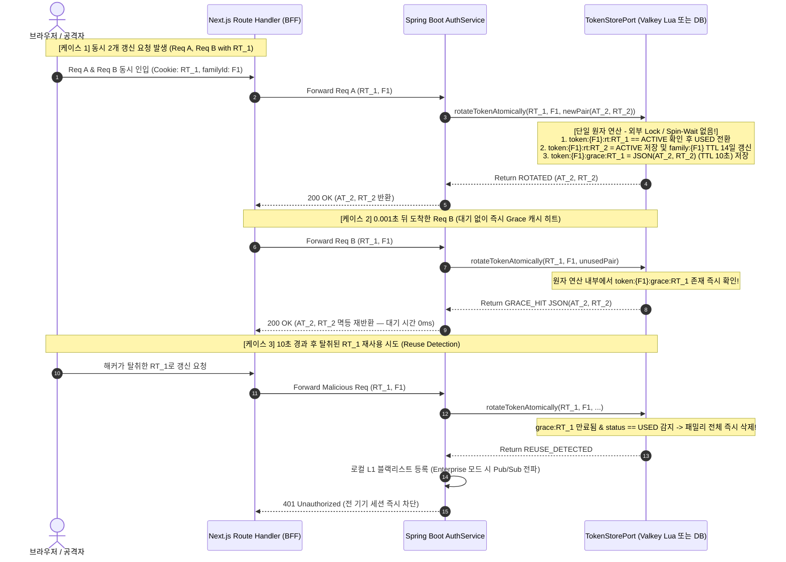
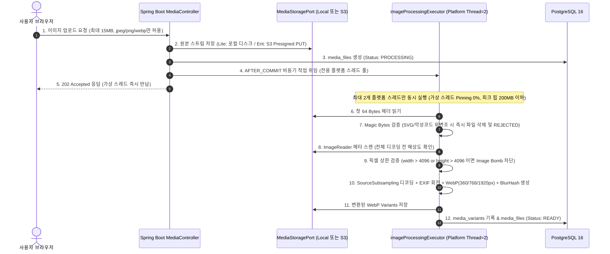
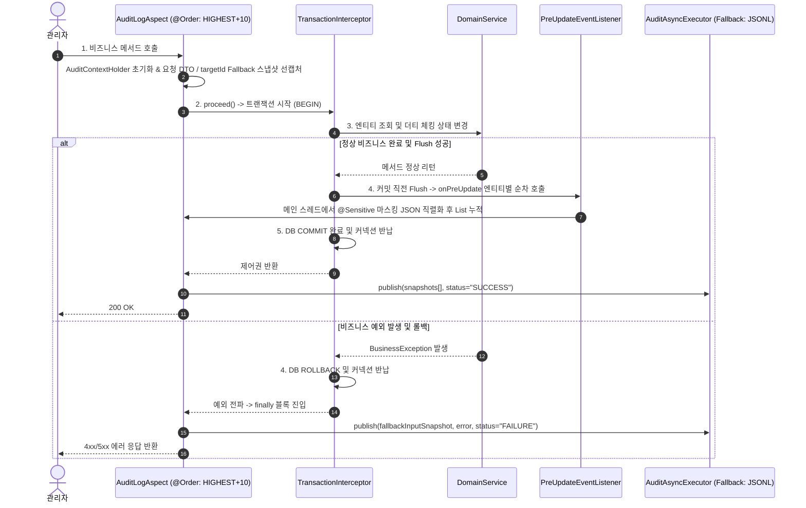

# 엔터프라이즈 홈페이지 & 관리자 통합 스타터 킷

## 상용화 기술 아키텍처 및 상세 기획서 (Technical Architecture & Engineering Specification)

> **버전**: v2.0-LITE & PRO (실용적 모듈러 모놀리스 개편판 — 중소형 외주 양산·템플릿 판매 최적화 및 기술 결함 완결 교정본)
>
> **작성일**: 2026년 11월 18일
>
> **설계 원칙**: 100% 라이선스 클린(Apache 2.0/MIT/BSD), 단일 모듈 패키지 격리(Modular Monolith) 기반 초고속 커스터마이징, `lite`(서버 1대 + DB 1대) $\leftrightarrow$ `enterprise`(Valkey + SeaweedFS 클러스터) 무코드 스위칭, Standard/Pro 기능 플래그(Feature Flag) 내장

---

## 1. 프로젝트 개요 및 상용화 핵심 전제

### 1.1 제품 미션 및 투트랙(Two-Track) 비즈니스 가치

본 스타터 킷은 **① 중소형 웹 에이전시 및 프리랜서의 초고속 외주 납품**, **② 코드 마켓플레이스(Standard / Pro 에디션) 템플릿 판매**, **③ 엔터프라이즈 B2B SaaS 및 공공·금융권 SI 확장**을 단일 코드베이스로 동시에 달성하도록 설계된 **풀스택 상용화 베이스 프레임워크**입니다.

* **Time to Market 및 외주 수익성 극대화**: 신규 프로젝트 착수 시 2~3개월이 소요되는 인증/인가(소셜 로그인·2FA 포함), 관리자 CMS, 동적 권한(RBAC), 대용량 미디어 처리, 감사 로그, 엑셀 스트리밍, 주문·결제 상태 머신 등의 기반 작업을 0일로 단축합니다.
* **초고속 커스터마이징을 위한 실용적 모듈러 모놀리스(Pragmatic Modular Monolith)**: 기존 4개 멀티 모듈의 복잡한 파일 이동과 내부 DB 조회용 포트(Port) 중복 선언을 제거하고 **단일 Spring Boot 프로젝트 내 패키지 격리 구조**로 통합했습니다. 게시판이나 컬럼 추가 시 수정해야 할 파일 수를 절반 이하로 줄여 외주 작업 속도를 3배 이상 높였습니다.
* **인프라 유지비 1/3 절감 (Lite $\leftrightarrow$ Enterprise 플러그인 아키텍처)**: 소규모 고객사 납품 시에는 외부 캐시(Valkey)나 오브젝트 스토리지(SeaweedFS) 없이 **Spring Boot + PostgreSQL 단 2개의 컨테이너(월 $10~$20 수준 서버 1대)**만으로 100% 동작하며, 트래픽 증가 시 환경 변수 하나로 Valkey와 S3/SeaweedFS가 결합된 엔터프라이즈 모드로 즉시 전환됩니다.
* **무결점 운영 안정성(Zero-Fault Engineering)**: CPU 집약적 이미지 처리의 전용 플랫폼 스레드 풀 격리(가상 스레드 Pinning 원천 차단) 및 수학적 JVM 힙 메모리 상한 통제($\le 256\text{ MB}$), JPA Flush 생명주기와 결합된 무결점 감사 로그, 외부 락이 필요 없는 단일 Lua Script 원자적 토큰 교환(RTR) 등 프로덕션 장애 포인트를 사전 방어 설계로 해결하였습니다.

### 1.2 100% 라이선스 안전성 보장 (Commercial Safe-Clean) & 모드별 인프라 매핑

상용 솔루션 재판매 및 고객사 납품 시 소스코드 공개 의무나 듀얼 라이선스 과금 분쟁을 원천 차단하기 위해, **AGPL, SSPL, GPL, BSL, Commons Clause** 계열의 모든 오픈소스 및 컨테이너 이미지를 배제하고 **Apache 2.0 / MIT / BSD 2,3-Clause** 라이선스만을 채택합니다.

| 분류 | Lite 모드 (기본 내장 / 소규모 외주) | Enterprise 모드 (대규모 확장) | 적용 라이선스 | 비고 / 배제된 대안 (사유) |
| :--- | :--- | :--- | :--- | :--- |
| **캐시 / 토큰 저장소** | **Caffeine (L1) + PostgreSQL** | **Valkey 8.0** | **Apache 2.0 / BSD-3** | Redis 7.4+ (RSALv2 / SSPLv1 상용화 제한 및 과금 이슈로 영구 배제) |
| **파일 스토리지** | **Local File System (내장 서빙)** | **SeaweedFS 3.x / AWS S3** | **Apache 2.0** | MinIO (AGPL-3.0 상용 패키징 시 소스코드 전면 공개 전염성 리스크 배제) |
| **RDBMS / 드라이버** | **PostgreSQL 16.x** | **PostgreSQL 16.x (HA)** | **PostgreSQL / BSD-2** | MySQL 8.x (GPLv2 Connector/J 상용 임베딩 배포 시 법무 리스크 차단) |
| **동적 쿼리 빌더** | **OpenFeign QueryDSL 6.x** | **OpenFeign QueryDSL 6.x** | **Apache 2.0** | 원조 QueryDSL 5.x (유지보수 중단 및 Jakarta EE 10+ 호환 패치 지연 대체) |
| **로컬 SMTP 테스팅** | **Mailpit** | **AWS SES / SMTP Relay** | **MIT License** | MailHog (유지보수 중단 및 아카이빙 이슈 대체) |
| **백엔드 프레임워크** | **Spring Boot 3.4+ / Java 21 LTS** | **Spring Boot 3.4+ / Java 21 LTS** | **Apache 2.0** | I/O 작업 가상 스레드(`Virtual Threads`) + CPU 작업 전용 스레드 풀 이원화 |
| **프론트엔드** | **Next.js 15+ / React 19** | **Next.js 15+ / React 19** | **MIT License** | App Router, Route Handler(BFF), shadcn/ui + TanStack Table (100% MIT) |

### 1.3 상품화 패키지 구성 (Standard vs Pro 투트랙 판매 전략)

템플릿 마켓플레이스 판매 및 외주 견적 산정 시 고객 예산에 맞춰 기능을 즉각 제어할 수 있도록 `application.yml`의 Feature Flag(`starter.features.*`) 기반 상품 등급 분리를 지원합니다.

| 구분 | 포함 기능 명세 | 권장 타깃 및 판매 모델 |
| :--- | :--- | :--- |
| **Standard Edition** (기본형) | • 대고객 회원가입 / 로그인 / 소셜 로그인 (Google, Kakao, Naver)<br>• 관리자 RBAC 동적 권한 및 동적 메뉴 트리 관리<br>• 통합 CMS (공지사항, FAQ, 배너, 팝업, 약관 관리)<br>• 사이트 기본 설정(`site_configs`) 및 공통 코드 관리<br>• 로컬/S3 이미지 업로드 및 WebP 자동 변환 파이프라인 | • 중소기업/스타트업 홍보용 홈페이지 외주<br>• 초기 MVP 빠르게 구축하기<br>• 코드 마켓 기본가(Standard) 라이선스 판매 |
| **Pro Edition** (고급형 옵션) | • **`starter.features.audit-log`**: `@AuditLog` 변경 전/후 스냅샷 감사 추적 및 파티셔닝<br>• **`starter.features.excel-export`**: 100만 건 SXSSF 비동기 엑셀 스트리밍 & 시트 자동 분할<br>• **`starter.features.admin-totp`**: 관리자 Google OTP(RFC 6238) 2단계 인증<br>• **`starter.features.payment`**: 표준 주문·결제 상태 머신 및 PG 웹훅 멱등성 엔진 | • 개인정보 취급 커머스 / 예약 / 핀테크 플랫폼 외주<br>• 공공기관 및 ISMS-P 인증 대상 기업 납품<br>• 코드 마켓 고단가(Pro/Extended) 라이선스 판매 |

---

## 2. 5대 핵심 아키텍처 의사결정 매트릭스

1. **단일 모듈 패키지 격리(Modular Monolith) + 런타임 프로필 분할 배포**:
   * 물리적 멀티 모듈을 단일 모듈로 통합하여 도메인 추가·수정 시의 개발 속도를 극대화합니다.
   * 배포 시에는 `--spring.profiles.active=all`(소규모 단일 서버 통합 구동) 또는 `public` / `admin`(대규모 물리 서버 분리 구동) 프로필을 통해 코드 변경 없이 배포 토폴로지를 자유롭게 선택합니다.
2. **내부 DB 직결(Pragmatic JPA/QueryDSL) + 외부 인프라만 Port 추상화**:
   * 서비스 계층에서 내부 DB 조회 시 불필요한 Outbound Port 인터페이스를 거치지 않고 `JpaRepository` 및 `QueryDSL Repository`를 직접 호출하여 보일러플레이트를 50% 이상 제거합니다.
   * 반면 환경별로 교체되는 **외부 인프라 4종(토큰/캐시 저장소, 파일 스토리지, 메일/알림 발송, 결제 PG)**만 Port 인터페이스로 추상화하여 `lite` 모드와 `enterprise` 모드를 무코드로 스위칭합니다.
3. **Next.js 15 App Router + OpenAPI 계약 자동화**:
   * 백엔드 OpenAPI 3.1 스펙으로부터 프론트엔드 TypeScript 타입과 API 클라이언트를 자동 생성(`orval`)하여 백엔드 컬럼 변경이 프론트엔드에 즉시 반영되도록 자동화합니다.
4. **워크로드별 스레드 이원화 (Java 21 Virtual Threads + CPU Dedicated Platform Pool)**:
   * 일반적인 웹 API, DB 조회, 외부 HTTP 호출 등 I/O 대기 작업은 **Java 21 가상 스레드(`Virtual Threads`)**로 처리하여 높은 처리량을 확보합니다.
   * 반면 고해상도 이미지 리사이징, WebP 인코딩, BlurHash 추출 등 **CPU 연산이 집중되는 작업은 가상 스레드 Pinning(운반 스레드 독점 현상)을 막기 위해 크기 2로 고정된 전용 일반 스레드 풀(`FixedThreadPool(2)`)**로 격리합니다.
5. **무락(Lock-Free) 원자적 JWT RTR & Dual-Mode 저장소**:
   * 평상시 API 인가는 서명 검증과 로컬 Caffeine L1 블랙리스트 조회만으로 $0.01\text{ ms}$ 내 무상태(Stateless) 처리합니다.
   * 토큰 갱신(RTR)은 외부 분산 락이나 스핀 대기 없이 **`enterprise` 모드에서는 단일 Valkey Lua Script 원자 연산**, **`lite` 모드에서는 PostgreSQL 행 잠금(`FOR UPDATE`) + 10초 Grace Window 컬럼**으로 동시성 충돌과 탈취 감지를 완벽히 처리합니다.

---

## 3. 시스템 아키텍처 청사진 & 단일 모듈 패키지 구조

### 3.1 실용적 모듈러 모놀리스(Pragmatic Modular Monolith) 아키텍처

```
+-----------------------------------------------------------------------------------+
|                        Presentation Layer (api 패키지)                             |
|   [api.public.* (대고객 컨트롤러)]            [api.admin.* (관리자 컨트롤러)]        |
|   (@Profile({"all", "public"}))             (@Profile({"all", "admin"}))          |
+----------------------------------------+------------------------------------------+
                                         | DTOs & Application Services
                                         v
+-----------------------------------------------------------------------------------+
|                   Core Domain & Application Layer (domain 패키지)                  |
|   [JPA Entities & Domain Services (@Transactional)]                               |
|   [Direct Repositories]: Spring Data JPA + OpenFeign QueryDSL 6.x (보일러플레이트 제거)|
|   -----------------------------------------------------------------------------   |
|   [External Infra Ports (4종만 추상화)]:                                           |
|    • TokenStorePort     • MediaStoragePort     • NotificationPort    • PaymentPort|
+----------------------------------------+------------------------------------------+
                                         | @ConditionalOnProperty ("starter.mode")
                    +--------------------+--------------------+
                    | (starter.mode=lite : 기본값)             | (starter.mode=enterprise)
                    v                                         v
+---------------------------------------+ +-----------------------------------------+
|     Lite Infra Adapters (infra.lite)  | | Enterprise Infra Adapters (infra.ent)   |
| • DB + Caffeine Token/Cache Adapter   | | • Valkey 8.0 Lua & Pub/Sub Adapter      |
| • Local Disk Media Storage Adapter    | | • SeaweedFS / AWS S3 Storage Adapter    |
| • Spring Async Event Worker           | | • Distributed Outbox & S3 Excel Engine  |
+---------------------------------------+ +-----------------------------------------+
```

### 3.2 디렉토리 및 패키지 구조 (직관적 커스터마이징 최적화)

외주 작업 시 새로운 기능(예: `inquiry` 견적 문의)을 추가할 때 한눈에 파악하고 복사·수정이 가능하도록 구성된 단일 프로젝트 구조입니다.

```
homepage-starter/
 ├── backend/ (Spring Boot 3.4 Single Module — Java 21)
 │    └── src/main/java/com/starterkit/
 │         ├── api/
 │         │    ├── pub/              # 대고객 API 컨트롤러 & 요청/응답 DTO (@Profile({"all", "public"}))
 │         │    └── admin/            # 관리자 API 컨트롤러 & 요청/응답 DTO (@Profile({"all", "admin"}))
 │         ├── domain/                # 비즈니스 핵심 도메인 (외주 수정 시 이 폴더와 api 폴더만 작업!)
 │         │    ├── member/           # Entity, MemberRepository(JPA+QueryDSL), MemberService
 │         │    ├── rbac/             # Admin, Role, Permission, Menu 도메인 및 서비스
 │         │    ├── cms/              # 공지, FAQ, 배너, 팝업, 약관 관리 도메인
 │         │    ├── media/            # 이미지 메타데이터 및 MediaStoragePort 인터페이스
 │         │    ├── order/            # 주문/결제 상태 머신 및 PaymentPort 인터페이스
 │         │    ├── audit/            # @AuditLog 어노테이션, Aspect 및 감사 로그 도메인
 │         │    └── export/           # 엑셀 다운로드 Job 도메인
 │         ├── infra/                 # 기술 구현체 (평소 외주 커스터마이징 시 수정 불필요)
 │         │    ├── config/           # Security, VirtualThread, ImageWorkerPool, OpenAPI 설정
 │         │    ├── lite/             # Lite 모드 어댑터 (LocalStorageAdapter, DbTokenStoreAdapter 등)
 │         │    ├── enterprise/       # Enterprise 모드 어댑터 (S3StorageAdapter, ValkeyLuaTokenAdapter 등)
 │         │    ├── audit/            # Hibernate PreUpdate 리스너 & JSONL Fallback 기록기
 │         │    ├── excel/            # SXSSF 스트리밍 및 자동 시트 분할 엔진
 │         │    └── worker/           # 고아 파일 정리, Outbox 폴링 스케줄러 (@ConditionalOnProperty)
 │         └── global/                # 공통 예외 처리(ProblemDetail), 유틸리티, 공통 응답 래퍼
 └── frontend/ (Next.js 15 App Router — TypeScript, shadcn/ui, TanStack Table)
```

### 3.3 단일 모듈용 ArchUnit 아키텍처 보호 테스트

멀티 모듈을 하나로 합쳤더라도 초·중급 개발자가 컨트롤러에서 JPA 엔티티를 직접 반환하거나 도메인이 인프라 구현체에 직접 결합되는 실수를 막기 위해 3가지 핵심 `ArchUnit` 테스트를 유지합니다.

```java
@AnalyzeClasses(packages = "com.starterkit", importOptions = ImportOption.DoNotIncludeTests.class)
public class ArchitectureLayerRulesTest {

    // 1. Domain 계층은 API(Controller)나 구체적인 Infra 어댑터 클래스를 직접 참조할 수 없다.
    @ArchTest
    static final ArchRule domain_must_not_depend_on_api_or_infra =
        noClasses().that().resideInAPackage("..domain..")
            .should().dependOnClassesThat().resideInAnyPackage("..api..", "..infra..");

    // 2. API(Controller) 계층은 Infra 어댑터(S3, Valkey, POI 등)에 직접 접근할 수 없다.
    @ArchTest
    static final ArchRule api_must_not_access_infra_directly =
        noClasses().that().resideInAPackage("..api..")
            .should().dependOnClassesThat().resideInAPackage("..infra..");

    // 3. 도메인 엔티티(@Entity)는 Controller 계층의 요청/응답 시그니처로 직접 노출될 수 없다.
    @ArchTest
    static final ArchRule entities_must_not_leak_to_controllers =
        noMethods().that().areDeclaredInClassesThat().resideInAPackage("..api..")
            .should().haveRawReturnType(annotatedWith(Entity.class))
            .orShould().haveRawParameterTypes(anyElementThat(annotatedWith(Entity.class)));
}
```

---

## 4. 5대 킬러 실무 기능 명세 (오버엔지니어링 교정 및 Lite/Enterprise 겸용)

### 4.1 [킬러 1] CPU 전용 스레드 풀 격리 & 수학적 힙 상한($\le 256\text{ MB}$) 이미지 파이프라인

상용 유료 이미지 SaaS 없이 고해상도 이미지를 WebP로 압축·서빙하며, **Java 21 가상 스레드 Pinning 현상 방지와 비압축 RGBA 힙 메모리 상한 통제, Stored XSS 차단**을 모두 달성한 파이프라인입니다.

* **핵심 교정 — CPU 집약적 이미지 작업의 전용 플랫폼 스레드 풀 격리**:
  * Spring Boot 3.4에서 `spring.threads.virtual.enabled=true`를 켜면 기본 `@Async` 작업도 가상 스레드에서 실행됩니다. 그러나 이미지 디코딩/인코딩(`Scrimage`, `TwelveMonkeys`) 및 BlurHash 계산은 순수 CPU 연산 및 네이티브 I/O를 동반하므로 가상 스레드에서 실행할 경우 기본 OS 운반 스레드(Carrier Thread)를 점유(Pinning)하여 전체 웹 API 응답 지연을 유발합니다.
  * 이를 원천 차단하기 위해 이미지 변환 워커는 **크기가 2로 고정된 전용 일반 플랫폼 스레드 풀(`@Async("imageProcessingExecutor")`)**에서 실행되도록 격리합니다.

```java
@Configuration
public class AsyncThreadPoolConfig {

    // CPU 연산 집중 작업(이미지 리사이징, WebP 변환, BlurHash) 전용 플랫폼 스레드 풀 (최대 동시 2건)
    @Bean(name = "imageProcessingExecutor")
    public Executor imageProcessingExecutor() {
        ThreadPoolTaskExecutor executor = new ThreadPoolTaskExecutor();
        executor.setCorePoolSize(2);
        executor.setMaxPoolSize(2);
        executor.setQueueCapacity(50);
        executor.setThreadNamePrefix("img-cpu-worker-");
        // 가상 스레드가 아닌 일반 OS 플랫폼 스레드 팩토리 명시적 사용
        executor.setThreadFactory(Thread.ofPlatform().name("img-cpu-worker-", 0).factory());
        executor.initialize();
        return executor;
    }
}
```

* **수학적 힙 메모리 상한 통제 ($\le 256\text{ MB}$ 엄격 보장)**:
  1. **픽셀 상한선($4096 \times 4096$) 및 Image Bomb 차단**: 자바 `BufferedImage`(RGBA 4바이트) 디코딩 시 $4096 \times 4096 \times 4\text{ bytes} \approx 67.1\text{ MB}$가 소요됩니다. 전체 이미지를 메모리에 올리기 전 `TwelveMonkeys ImageReader`로 헤더만 읽어 가로·세로 $4096\text{ px}$(또는 총 픽셀 $16.7\text{ MP}$) 초과 시 디코딩 없이 즉시 거부합니다.
  2. **Source Subsampling & 워커 스레드 2개 제한**: 리사이징 시 원본 버퍼와 타깃 버퍼를 합쳐 1장당 최대 약 $100\text{ MB}$의 힙이 사용됩니다. `ImageReadParam.setSourceSubsampling()`으로 샘플링 디코딩하여 메모리를 절약하고, `imageProcessingExecutor`의 최대 스레드 수를 2개로 고정하여 피크 타임에도 이미지 처리용 총 힙 메모리가 절대 $200 \sim 256\text{ MB}$를 넘지 않도록 수학적으로 통제합니다.
* **Lite 모드 vs Enterprise 모드 업로드 동작**:
  * **Lite 모드 (`starter.mode=lite`)**: 멀티파트 스트리밍으로 서버의 지정된 로컬 볼륨(`./storage/media`)에 임시 저장 후 `imageProcessingExecutor`가 매직 바이트 검증(SVG 차단) 및 WebP(`360px`, `768px`, `1920px`) 변환을 수행합니다.
  * **Enterprise 모드 (`starter.mode=enterprise`)**: S3/SeaweedFS Presigned PUT URL을 발급해 클라이언트가 스토리지로 직접 업로드한 뒤, 완료 콜백 시 워커가 S3 Range 요청(`bytes=0-63`) 검증 및 변환을 수행합니다.

### 4.2 [킬러 2] 트랜잭션 Flush 순서가 보장된 감사 로그(`@AuditLog`) [Pro 기능 스위치 지원]

개인정보보호법(ISMS-P)을 만족하며, `starter.features.audit-log.enabled=true`(기본값 `true`)로 제어되는 무결점 감사 추적 시스템입니다.

* **AOP 우선순위(`@Order`) 교정 및 다중 엔티티 스냅샷 누적**:
  1. **Flush 순서 역전 해결**: `AuditLogAspect`에 `@Order(Ordered.HIGHEST_PRECEDENCE + 10)`을 부여하여 `TransactionInterceptor`보다 바깥쪽에서 감싸도록 설계합니다.
  2. **다중 엔티티 수정 누적 (`List<EntityAuditSnapshot>`) & `LazyInitializationException` 차단**: 한 트랜잭션 내에서 여러 엔티티가 수정될 때 스냅샷이 덮어씌워지지 않도록 `AuditContextHolder`가 리스트로 누적 관리하며, Hibernate `PreUpdateEventListener` 실행 즉시 메인 스레드에서 `@Sensitive` 마스킹 JSON 직렬화를 완료합니다.
  3. **롤백 대비 입력 스냅샷 사전 캡처 & 무손실 Fallback**: AOP 진입 시점에 요청 DTO와 `targetId`를 먼저 캡처하여 비즈니스 예외 롤백(`FAILURE`) 시에도 요청 컨텍스트를 남기며, DB 장애 시 로컬 롤링 파일(`logs/audit-fallback.jsonl`)로 우회 기록합니다.

### 4.3 [킬러 3] 무락(Lock-Free) 원자적 JWT RTR & Dual-Mode(DB / Valkey Lua) 인증

평상시 API 호출 시에는 완전 무상태(Stateless) 성능을 유지하면서, 토큰 갱신(Refresh Token Rotation) 시에는 **불필요한 외부 분산 락과 스핀 대기(Spin-wait)를 제거하고 10초 Grace Window를 원자적으로 처리**하는 아키텍처입니다.

* **평상시 API 호출의 완전 무상태화 ($0.01\text{ ms}$ 인가)**:
  * `Access Token`(수명 15분) 검증 시 DB나 Valkey를 조회하지 않고, 서버 자체 서명 검증과 로컬 인메모리 L1 캐시(`Caffeine`)의 `blacklist:family:{familyId}` 여부만 확인합니다.
* **핵심 교정 — 외부 분산 락 및 Spin-wait 제거 (단일 원자 연산으로 통합)**:
  * 기존 기획서(v1.2.1)에서는 `rotate_refresh_token.lua` 실행 전에 별도의 `SET lock:{F1}:rt:RT_1 NX` 분산 락을 걸고 가상 스레드에서 $50\text{ ms}$씩 Spin-wait를 수행했으나, **Valkey의 Lua Script는 단일 스레드에서 그 자체로 100% 원자적(Atomic)으로 직렬 실행**되므로 외부 락과 대기 로직이 전혀 필요 없습니다.
  * 동시에 2개의 갱신 요청(Req A, Req B)이 도착하더라도 Valkey가 `EVAL rotate_refresh_token.lua`를 순차 실행하여, **첫 번째 요청은 토큰을 교체하고 10초 유예 캐시(`token:{F1}:grace:RT_1`)를 남기며, $0.001\text{ ms}$ 뒤에 실행된 두 번째 요청은 대기 없이 즉시 Lua 내부에서 유예 캐시를 읽고(`GRACE_HIT`) 동일한 신규 토큰 쌍을 반환**합니다.
* **Lite 모드 vs Enterprise 모드 RTR 동작**:
  * **Lite 모드 (PostgreSQL + Caffeine)**: `refresh_tokens` 테이블에서 `SELECT ... FOR UPDATE` 비관적 락으로 행을 조회하여, 상태가 `ACTIVE`이면 `USED`로 바꾸고 `grace_expires_at = NOW() + 10초` 및 대체 토큰 값을 기록합니다. 10초 이내 동시 요청은 캐시된 신규 토큰을 즉시 반환하고, 10초 경과 후 `USED` 토큰 재사용 시 해당 `family_id` 전체를 폐기합니다.
  * **Enterprise 모드 (Valkey 8.0 Lua + Pub/Sub)**: `{familyId}` Hash Tag가 적용된 단일 Lua 스크립트(`rotate_refresh_token.lua`)로 상태 전이, `family:{F1}` 만료시간(`EXPIRE 1209600`) 갱신, 10초 Grace 캐시 저장을 한 번에 처리하며, 탈취 감지 시 Valkey Pub/Sub으로 전 서버의 L1 블랙리스트를 동기화합니다.

### 4.4 [킬러 4] SXSSF + QueryDSL DTO 프로젝션 & 자동 시트 분할 엑셀 스트리밍 [Pro 기능]

* **QueryDSL DTO 프로젝션 + Keyset(No-Offset) 페이징**: JPA 1차 캐시에 엔티티가 쌓이지 않도록 `Projections.constructor` DTO 조회와 `WHERE id > :lastSeenId ORDER BY id ASC LIMIT 1000` 커서 방식을 결합합니다.
* **단일 시트 한계 돌파 (자동 Sheet Split)**: Excel(`.xlsx`) 단일 시트 최대 행 수($1,048,576$행) 제한을 넘지 않도록 시트당 $1,000,000$행 도달 시 자동으로 `Sheet_2`, `Sheet_3`를 생성하고, `SXSSFWorkbook(500)`으로 메모리 상주 행을 500개로 제한합니다.
* **다운로드 방식**: `lite` 모드에서는 일회용 서명 토큰이 포함된 백엔드 직접 스트리밍 URL을, `enterprise` 모드에서는 S3/SeaweedFS Presigned GET URL을 발급하여 Next.js BFF 서버의 메모리 버퍼링을 피합니다.

### 4.5 [킬러 5] 트랜잭션 커밋 후(`AFTER_COMMIT`) 동적 설정 및 RBAC 캐시 동기화

* `@TransactionalEventListener(phase = TransactionPhase.AFTER_COMMIT)`를 사용하여 PostgreSQL 트랜잭션 커밋이 확정된 직후에만 로컬 L1 캐시(`Caffeine`)를 비우고, `enterprise` 모드일 때는 추가로 Valkey Pub/Sub 브로드캐스트를 발행하여 다중 서버 간 Stale Cache Read를 원천 방지합니다.

---

## 5. 핵심 도메인 데이터 모델링 및 ERD 명세 (PostgreSQL 16 표준)

### 5.1 데이터베이스 아키텍처, PK 이원화 및 Soft Delete 표준

* **내부 PK 및 외부 식별자 이원화**: 내부 조인 및 Keyset 페이징용 기본키는 `BIGINT GENERATED ALWAYS AS IDENTITY`를 사용하고, 외부 API에 노출되는 식별자(`members`, `orders`, `export_jobs`)는 시간순 정렬이 가능한 **`UUID` (UUIDv7)**를 사용하여 ID 추측 공격(IDOR)을 방어합니다.
* **PostgreSQL Partial Index 기반 Soft Delete**: `deleted_at TIMESTAMP WITH TIME ZONE` 컬럼과 **`WHERE deleted_at IS NULL` 조건부 부분 유니크 인덱스**를 결합하여, 회원 탈퇴 후 동일 이메일 재가입 및 삭제된 CMS 슬러그(`slug`) 재사용을 완벽히 지원합니다.

### 5.2 주요 테이블 스키마 DDL 정의서

#### 1) members, member_oauth_accounts & refresh_tokens (회원, 소셜 로그인 및 Lite 모드 겸용 RTR 테이블)
```sql
CREATE TABLE members (
    id BIGINT GENERATED ALWAYS AS IDENTITY PRIMARY KEY,
    public_id UUID NOT NULL UNIQUE,               -- 외부 API 노출용 UUIDv7
    email VARCHAR(255) NOT NULL,
    password_hash VARCHAR(255),                   -- 소셜 전용 가입 시 NULL 허용
    nickname VARCHAR(100) NOT NULL,
    phone_number VARCHAR(50),
    status VARCHAR(30) NOT NULL DEFAULT 'ACTIVE', -- ACTIVE, SUSPENDED, WITHDRAWN
    role VARCHAR(30) NOT NULL DEFAULT 'USER',     -- USER, VIP
    site_code VARCHAR(50) NOT NULL DEFAULT 'MAIN',
    email_verified_at TIMESTAMP WITH TIME ZONE,
    last_login_at TIMESTAMP WITH TIME ZONE,
    created_at TIMESTAMP WITH TIME ZONE NOT NULL DEFAULT CURRENT_TIMESTAMP,
    updated_at TIMESTAMP WITH TIME ZONE NOT NULL DEFAULT CURRENT_TIMESTAMP,
    deleted_at TIMESTAMP WITH TIME ZONE           -- Soft Delete 타임스탬프
);
CREATE UNIQUE INDEX uq_members_email_active ON members(email, site_code) WHERE deleted_at IS NULL;
CREATE INDEX idx_members_created_at ON members(created_at) WHERE deleted_at IS NULL;

CREATE TABLE member_oauth_accounts (
    id BIGINT GENERATED ALWAYS AS IDENTITY PRIMARY KEY,
    member_id BIGINT NOT NULL REFERENCES members(id) ON DELETE CASCADE,
    provider VARCHAR(30) NOT NULL,                -- GOOGLE, KAKAO, NAVER
    provider_user_id VARCHAR(255) NOT NULL,
    provider_email VARCHAR(255),
    connected_at TIMESTAMP WITH TIME ZONE NOT NULL DEFAULT CURRENT_TIMESTAMP,
    UNIQUE (provider, provider_user_id)
);
CREATE INDEX idx_oauth_member_id ON member_oauth_accounts(member_id);

-- [신규 추가] Lite 모드(Valkey 미사용 환경)에서 100% 동일한 원자적 RTR 및 10초 Grace Window를 제공하는 테이블
CREATE TABLE refresh_tokens (
    id BIGINT GENERATED ALWAYS AS IDENTITY PRIMARY KEY,
    token_hash VARCHAR(128) NOT NULL UNIQUE,      -- SHA-256 해싱된 Refresh Token 식별자
    family_id UUID NOT NULL,                      -- 토큰 패밀리 추적 ID (탈취 감지 시 일괄 폐기 단위)
    actor_type VARCHAR(20) NOT NULL,              -- USER, ADMIN
    actor_id BIGINT NOT NULL,
    status VARCHAR(20) NOT NULL DEFAULT 'ACTIVE', -- ACTIVE, USED, REVOKED
    grace_until TIMESTAMP WITH TIME ZONE,         -- USED 전환 후 10초 유예 만료 시각
    replaced_by_token_pair JSONB,                 -- 10초 유예 기간 동안 동시 요청에 반환할 신규 토큰 쌍 캐시
    expires_at TIMESTAMP WITH TIME ZONE NOT NULL,
    created_at TIMESTAMP WITH TIME ZONE NOT NULL DEFAULT CURRENT_TIMESTAMP
);
CREATE INDEX idx_refresh_tokens_family ON refresh_tokens(family_id);
CREATE INDEX idx_refresh_tokens_expires ON refresh_tokens(expires_at);
```

#### 2) admins, roles, permissions, admin_roles, role_permissions (관리자 RBAC)
```sql
CREATE TABLE admins (
    id BIGINT GENERATED ALWAYS AS IDENTITY PRIMARY KEY,
    username VARCHAR(100) NOT NULL,
    password_hash VARCHAR(255) NOT NULL,
    full_name VARCHAR(100) NOT NULL,
    email VARCHAR(255) NOT NULL,
    status VARCHAR(30) NOT NULL DEFAULT 'ACTIVE', -- ACTIVE, LOCKED
    totp_secret VARCHAR(255),                     -- AES-256-GCM 암호화 저장된 Google 2FA Secret
    is_totp_enabled BOOLEAN NOT NULL DEFAULT FALSE,
    failed_login_attempts INT NOT NULL DEFAULT 0,
    created_at TIMESTAMP WITH TIME ZONE NOT NULL DEFAULT CURRENT_TIMESTAMP,
    updated_at TIMESTAMP WITH TIME ZONE NOT NULL DEFAULT CURRENT_TIMESTAMP,
    deleted_at TIMESTAMP WITH TIME ZONE
);
CREATE UNIQUE INDEX uq_admins_username_active ON admins(username) WHERE deleted_at IS NULL;
CREATE UNIQUE INDEX uq_admins_email_active ON admins(email) WHERE deleted_at IS NULL;

CREATE TABLE roles (
    id BIGINT GENERATED ALWAYS AS IDENTITY PRIMARY KEY,
    role_code VARCHAR(50) NOT NULL UNIQUE,        -- ROLE_SUPER_ADMIN, ROLE_CONTENT_MANAGER
    role_name VARCHAR(100) NOT NULL,
    description TEXT,
    created_at TIMESTAMP WITH TIME ZONE NOT NULL DEFAULT CURRENT_TIMESTAMP
);

CREATE TABLE permissions (
    id BIGINT GENERATED ALWAYS AS IDENTITY PRIMARY KEY,
    permission_code VARCHAR(100) NOT NULL UNIQUE, -- member:read, member:export, content:write
    permission_name VARCHAR(100) NOT NULL,
    resource_type VARCHAR(50) NOT NULL,
    created_at TIMESTAMP WITH TIME ZONE NOT NULL DEFAULT CURRENT_TIMESTAMP
);

CREATE TABLE admin_roles (
    admin_id BIGINT NOT NULL REFERENCES admins(id) ON DELETE CASCADE,
    role_id BIGINT NOT NULL REFERENCES roles(id) ON DELETE CASCADE,
    PRIMARY KEY (admin_id, role_id)
);

CREATE TABLE role_permissions (
    role_id BIGINT NOT NULL REFERENCES roles(id) ON DELETE CASCADE,
    permission_id BIGINT NOT NULL REFERENCES permissions(id) ON DELETE CASCADE,
    PRIMARY KEY (role_id, permission_id)
);
```

#### 3) menus, site_configs, common_codes (동적 메뉴 및 환경 설정)
```sql
CREATE TABLE menus (
    id BIGINT GENERATED ALWAYS AS IDENTITY PRIMARY KEY,
    parent_id BIGINT REFERENCES menus(id) ON DELETE CASCADE,
    menu_name VARCHAR(100) NOT NULL,
    route_path VARCHAR(255),
    icon_name VARCHAR(50),
    sort_order INT NOT NULL DEFAULT 0,
    is_visible BOOLEAN NOT NULL DEFAULT TRUE,
    required_permission VARCHAR(100),
    created_at TIMESTAMP WITH TIME ZONE NOT NULL DEFAULT CURRENT_TIMESTAMP
);
CREATE INDEX idx_menus_parent_sort ON menus(parent_id, sort_order);

CREATE TABLE site_configs (
    config_key VARCHAR(100) NOT NULL,
    site_code VARCHAR(50) NOT NULL DEFAULT 'MAIN',
    config_value TEXT NOT NULL,
    value_type VARCHAR(20) NOT NULL DEFAULT 'STRING', -- STRING, NUMBER, BOOLEAN, JSON
    group_name VARCHAR(50) NOT NULL,
    description TEXT,
    is_public BOOLEAN NOT NULL DEFAULT FALSE,
    updated_by VARCHAR(100),
    updated_at TIMESTAMP WITH TIME ZONE NOT NULL DEFAULT CURRENT_TIMESTAMP,
    PRIMARY KEY (config_key, site_code)
);

CREATE TABLE common_codes (
    group_code VARCHAR(50) NOT NULL,
    code_value VARCHAR(50) NOT NULL,
    code_name VARCHAR(100) NOT NULL,
    sort_order INT NOT NULL DEFAULT 0,
    is_active BOOLEAN NOT NULL DEFAULT TRUE,
    extra_json JSONB,
    PRIMARY KEY (group_code, code_value)
);
```

#### 4) audit_logs (PostgreSQL 월별 파티셔닝 및 JSONB 스냅샷)
```sql
CREATE TABLE audit_logs (
    id BIGINT GENERATED ALWAYS AS IDENTITY,
    action_type VARCHAR(50) NOT NULL,             -- CREATE, UPDATE, DELETE, VIEW, EXPORT, AUTH_FAIL
    domain_type VARCHAR(50) NOT NULL,             -- MEMBER, ORDER, CMS, CONFIG, SECURITY
    target_id VARCHAR(100),
    actor_id VARCHAR(100) NOT NULL,
    actor_type VARCHAR(30) NOT NULL,              -- ADMIN, USER, SYSTEM
    execution_status VARCHAR(20) NOT NULL DEFAULT 'SUCCESS',
    error_message TEXT,
    client_ip VARCHAR(45) NOT NULL,
    user_agent TEXT,
    before_state JSONB,
    after_state JSONB,
    diff_payload JSONB,
    created_at TIMESTAMP WITH TIME ZONE NOT NULL DEFAULT CURRENT_TIMESTAMP,
    PRIMARY KEY (id, created_at)
) PARTITION BY RANGE (created_at);

CREATE TABLE audit_logs_2026_11 PARTITION OF audit_logs
    FOR VALUES FROM ('2026-11-01 00:00:00+00') TO ('2026-12-01 00:00:00+00');
CREATE TABLE audit_logs_default PARTITION OF audit_logs DEFAULT;

CREATE INDEX idx_audit_logs_actor ON audit_logs(actor_id, action_type, created_at DESC);
CREATE INDEX idx_audit_logs_domain_target ON audit_logs(domain_type, target_id, created_at DESC);
CREATE INDEX idx_audit_logs_diff_gin ON audit_logs USING gin (diff_payload);
```

#### 5) media_files, media_variants, orders, payment_transactions, export_jobs, outbox_events, cms_contents
```sql
CREATE TABLE media_files (
    id BIGINT GENERATED ALWAYS AS IDENTITY PRIMARY KEY,
    original_filename VARCHAR(255) NOT NULL,
    storage_key VARCHAR(500) NOT NULL UNIQUE,
    content_type VARCHAR(100) NOT NULL,           -- image/jpeg, image/png, image/webp (SVG 차단)
    file_size BIGINT NOT NULL,
    width INT,
    height INT,
    blur_hash VARCHAR(100),
    status VARCHAR(30) NOT NULL DEFAULT 'PENDING',-- PENDING, PROCESSING, READY, REJECTED, FAILED
    uploaded_by VARCHAR(100),
    created_at TIMESTAMP WITH TIME ZONE NOT NULL DEFAULT CURRENT_TIMESTAMP,
    deleted_at TIMESTAMP WITH TIME ZONE
);
CREATE INDEX idx_media_orphan_cleanup ON media_files(status, created_at) WHERE status = 'PENDING';

CREATE TABLE media_variants (
    id BIGINT GENERATED ALWAYS AS IDENTITY PRIMARY KEY,
    media_file_id BIGINT NOT NULL REFERENCES media_files(id) ON DELETE CASCADE,
    variant_type VARCHAR(30) NOT NULL,            -- THUMBNAIL(360px), MEDIUM(768px), LARGE(1920px)
    storage_key VARCHAR(500) NOT NULL,
    format VARCHAR(20) NOT NULL DEFAULT 'WEBP',
    width INT NOT NULL,
    height INT NOT NULL,
    file_size BIGINT NOT NULL,
    created_at TIMESTAMP WITH TIME ZONE NOT NULL DEFAULT CURRENT_TIMESTAMP
);
CREATE INDEX idx_media_variants_file ON media_variants(media_file_id, variant_type);

CREATE TABLE orders (
    id BIGINT GENERATED ALWAYS AS IDENTITY PRIMARY KEY,
    public_id UUID NOT NULL UNIQUE,
    member_id BIGINT NOT NULL REFERENCES members(id),
    order_name VARCHAR(255) NOT NULL,
    total_amount NUMERIC(15, 2) NOT NULL,
    currency VARCHAR(10) NOT NULL DEFAULT 'KRW',
    status VARCHAR(30) NOT NULL DEFAULT 'PENDING',-- PENDING, PAID, FAILED, CANCELLED, REFUNDED
    created_at TIMESTAMP WITH TIME ZONE NOT NULL DEFAULT CURRENT_TIMESTAMP,
    updated_at TIMESTAMP WITH TIME ZONE NOT NULL DEFAULT CURRENT_TIMESTAMP
);
CREATE INDEX idx_orders_member_created ON orders(member_id, created_at DESC);

CREATE TABLE payment_transactions (
    id BIGINT GENERATED ALWAYS AS IDENTITY PRIMARY KEY,
    order_id BIGINT NOT NULL REFERENCES orders(id),
    idempotency_key VARCHAR(100) NOT NULL UNIQUE,
    pg_provider VARCHAR(50) NOT NULL,             -- MOCK, TOSS, PORTONE, STRIPE
    pg_transaction_id VARCHAR(255),
    amount NUMERIC(15, 2) NOT NULL,
    status VARCHAR(30) NOT NULL,                  -- READY, APPROVED, FAILED, CANCELLED
    raw_webhook_payload JSONB,
    created_at TIMESTAMP WITH TIME ZONE NOT NULL DEFAULT CURRENT_TIMESTAMP
);
CREATE INDEX idx_payment_tx_order ON payment_transactions(order_id);

CREATE TABLE export_jobs (
    id BIGINT GENERATED ALWAYS AS IDENTITY PRIMARY KEY,
    public_id UUID NOT NULL UNIQUE,
    job_type VARCHAR(50) NOT NULL,                -- MEMBER_LIST, AUDIT_LOGS, ORDERS
    status VARCHAR(30) NOT NULL DEFAULT 'PENDING',
    total_count INT NOT NULL DEFAULT 0,
    processed_count INT NOT NULL DEFAULT 0,
    file_storage_key VARCHAR(500),
    requester_id VARCHAR(100) NOT NULL,
    error_message TEXT,
    started_at TIMESTAMP WITH TIME ZONE,
    completed_at TIMESTAMP WITH TIME ZONE,
    created_at TIMESTAMP WITH TIME ZONE NOT NULL DEFAULT CURRENT_TIMESTAMP
);

CREATE TABLE outbox_events (
    id BIGINT GENERATED ALWAYS AS IDENTITY PRIMARY KEY,
    aggregate_type VARCHAR(100) NOT NULL,
    aggregate_id VARCHAR(100) NOT NULL,
    event_type VARCHAR(100) NOT NULL,             -- SEND_EMAIL, SEND_ALIMTALK, SEND_WEBHOOK
    payload JSONB NOT NULL,
    status VARCHAR(30) NOT NULL DEFAULT 'PENDING',
    retry_count INT NOT NULL DEFAULT 0,
    next_retry_at TIMESTAMP WITH TIME ZONE NOT NULL DEFAULT CURRENT_TIMESTAMP,
    created_at TIMESTAMP WITH TIME ZONE NOT NULL DEFAULT CURRENT_TIMESTAMP
);
CREATE INDEX idx_outbox_pending ON outbox_events(status, next_retry_at) WHERE status = 'PENDING';

CREATE TABLE cms_contents (
    id BIGINT GENERATED ALWAYS AS IDENTITY PRIMARY KEY,
    slug VARCHAR(200) NOT NULL,
    site_code VARCHAR(50) NOT NULL DEFAULT 'MAIN',
    title VARCHAR(300) NOT NULL,
    category VARCHAR(50) NOT NULL,                -- NOTICE, FAQ, TERMS, BANNER, POPUP
    content_html TEXT,
    content_json JSONB,
    view_count BIGINT NOT NULL DEFAULT 0,
    is_published BOOLEAN NOT NULL DEFAULT FALSE,
    published_at TIMESTAMP WITH TIME ZONE,
    author_id VARCHAR(100),
    created_at TIMESTAMP WITH TIME ZONE NOT NULL DEFAULT CURRENT_TIMESTAMP,
    updated_at TIMESTAMP WITH TIME ZONE NOT NULL DEFAULT CURRENT_TIMESTAMP,
    deleted_at TIMESTAMP WITH TIME ZONE
);
CREATE UNIQUE INDEX uq_cms_slug_active ON cms_contents(slug, site_code) WHERE deleted_at IS NULL;
```

---

## 6. 핵심 비즈니스 처리 흐름 시퀀스 다이어그램 (결함 교정 반영)

### 6.1 [시퀀스 1] 무락(Lock-Free) 단일 원자 연산 기반 JWT RTR 및 10초 Grace Window

불필요한 외부 분산 락(`SET NX`)과 가상 스레드 $50\text{ ms}$ Spin-wait를 완전히 제거하고, 단일 원자 호출(`rotate_refresh_token.lua` 또는 DB `FOR UPDATE`)만으로 동시 요청과 탈취 감지를 즉시 처리하는 흐름입니다.



### 6.2 [시퀀스 2] 전용 플랫폼 스레드 풀(`FixedThreadPool=2`) 기반 이미지 최적화 파이프라인

가상 스레드 Pinning을 방지하기 위해 `imageProcessingExecutor`(일반 OS 스레드 2개 고정)에서 실행되며, 수학적 힙 상한($\le 256\text{ MB}$)을 보장하는 흐름입니다.



### 6.3 [시퀀스 3] `@AuditLog` 다중 스냅샷 누적 & 실패 Fallback 입력 캡처 흐름



---

## 7. 부록: Lite / Enterprise 겸용 설정 규격 (`application.yml` & `docker-compose.yml`)

### 7.1 `application.yml` 모드 스위칭 및 Standard/Pro 기능 플래그 규격

코드 수정 없이 설정 파일 변경만으로 소규모 외주(`lite` + Standard)부터 대기업 납품(`enterprise` + Pro)까지 즉시 전환할 수 있습니다.

```yaml
spring:
  application:
    name: enterprise-starter-kit
  profiles:
    active: ${SPRING_PROFILES_ACTIVE:all} # all(단일서버 통합), public(대고객 전용), admin(관리자+워커 전용)
  threads:
    virtual:
      enabled: true # 일반 I/O API는 Java 21 가상 스레드 기본 활성화 (이미지 처리는 전용 플랫폼 풀 사용)

starter:
  # 1. 인프라 구동 모드 스위치: lite (PostgreSQL + 로컬 디스크 + Caffeine) | enterprise (Valkey + SeaweedFS/S3)
  mode: ${STARTER_MODE:lite}

  # 2. 백그라운드 배치 워커 실행 여부 (all 또는 admin 프로필에서 true 권장)
  worker:
    enabled: ${STARTER_WORKER_ENABLED:true}

  # 3. 템플릿 상품 등급(Standard / Pro) 및 외주 옵션 제어용 Feature Flags
  features:
    audit-log:
      enabled: ${FEATURE_AUDIT_LOG:true}      # [Pro] @AuditLog 변경 전/후 스냅샷 감사 로그
    excel-export:
      enabled: ${FEATURE_EXCEL_EXPORT:true}   # [Pro] 대용량 SXSSF 비동기 엑셀 스트리밍
    admin-totp:
      enabled: ${FEATURE_ADMIN_TOTP:true}     # [Pro] 관리자 Google OTP 2단계 인증
    payment:
      enabled: ${FEATURE_PAYMENT:true}        # [Pro] 주문/결제 상태 머신 및 웹훅 멱등성 모듈
```

### 7.2 Docker Compose V2 프로파일 기반 스마트 구동 스펙

* **중소형 외주 / 가벼운 로컬 개발 시 (`lite` 모드)**: `docker compose up -d` 명령어만 입력하면 **PostgreSQL 16과 Mailpit 단 2개의 컨테이너**만 가볍게 구동됩니다.
* **엔터프라이즈 모드 구동 시 (`enterprise` 모드)**: `docker compose --profile enterprise up -d` 명령어를 입력하면 **Valkey 8.0과 SeaweedFS(초기 버킷 자동 생성 포함)**까지 전체 스택이 구동됩니다.

```yaml
services:
  postgres:
    image: postgres:16.4-alpine
    container_name: starter-postgres
    restart: unless-stopped
    environment:
      POSTGRES_DB: ${POSTGRES_DB:-starter_db}
      POSTGRES_USER: ${POSTGRES_USER:-starter_user}
      POSTGRES_PASSWORD: ${POSTGRES_PASSWORD:-starter_secure_password_2026}
    ports:
      - "${POSTGRES_PORT:-5432}:5432"
    volumes:
      - pgdata:/var/lib/postgresql/data
    healthcheck:
      test: ["CMD-SHELL", "pg_isready -U $${POSTGRES_USER} -d $${POSTGRES_DB}"]
      interval: 5s
      timeout: 5s
      retries: 5

  mailpit:
    image: axllent/mailpit:v1.21
    container_name: starter-mailpit
    restart: unless-stopped
    ports:
      - "${MAILPIT_UI_PORT:-8025}:8025"
      - "${MAILPIT_SMTP_PORT:-1025}:1025"
    healthcheck:
      test: ["CMD", "/mailpit", "readyz"]
      interval: 5s
      timeout: 3s
      retries: 5

  # =========================================================================
  # 아래 컨테이너들은 --profile enterprise 옵션 지정 시에만 선택적으로 구동됩니다.
  # =========================================================================
  valkey:
    image: valkey/valkey:8.0.1-alpine
    container_name: starter-valkey
    profiles: ["enterprise"]
    restart: unless-stopped
    command: ["valkey-server", "--requirepass", "${VALKEY_PASSWORD:-valkey_secure_pass_2026}", "--appendonly", "yes"]
    ports:
      - "${VALKEY_PORT:-6379}:6379"
    volumes:
      - valkeydata:/data
    healthcheck:
      test: ["CMD", "valkey-cli", "-a", "${VALKEY_PASSWORD:-valkey_secure_pass_2026}", "ping"]
      interval: 5s
      timeout: 3s
      retries: 5

  seaweedfs:
    image: chrislusf/seaweedfs:3.79
    container_name: starter-seaweedfs
    profiles: ["enterprise"]
    restart: unless-stopped
    command: "server -dir=/data -s3 -s3.port=8333 -filer"
    ports:
      - "${S3_PORT:-8333}:8333"
      - "9333:9333"
      - "8888:8888"
    volumes:
      - seaweeddata:/data
    healthcheck:
      test: ["CMD-SHELL", "wget -qO- http://localhost:9333/cluster/status >/dev/null 2>&1 || exit 1"]
      interval: 5s
      timeout: 5s
      retries: 5

  seaweedfs-init:
    image: curlimages/curl:8.10.1
    container_name: starter-seaweedfs-init
    profiles: ["enterprise"]
    depends_on:
      seaweedfs:
        condition: service_healthy
    entrypoint:
      - /bin/sh
      - -c
      - |
        set -eu
        echo "Initializing default S3 bucket (starter-bucket) in SeaweedFS Filer..."
        for i in 1 2 3 4 5; do
          if curl -sf -X POST "http://seaweedfs:8888/buckets/starter-bucket/" >/dev/null; then
            echo "Default S3 bucket initialized successfully."
            exit 0
          fi
          HTTP_CODE=$$(curl -s -o /dev/null -w "%{http_code}" "http://seaweedfs:8888/buckets/starter-bucket/")
          if [ "$$HTTP_CODE" = "200" ] || [ "$$HTTP_CODE" = "409" ]; then
            echo "Default S3 bucket already exists (HTTP $$HTTP_CODE)."
            exit 0
          fi
          sleep 2
        done
        exit 1
    restart: "no"

volumes:
  pgdata:
  valkeydata:
  seaweeddata:
```

---
*본 문서는 중소형 외주 에이전시 양산 및 템플릿 마켓(Standard/Pro) 판매와 엔터프라이즈 확장을 동시에 지원하는 통합 스타터 킷(v2.0-LITE & PRO)의 최종 구현 규격서입니다.*